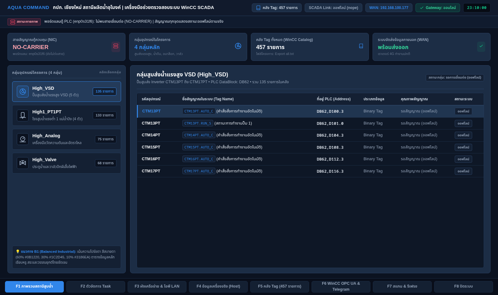
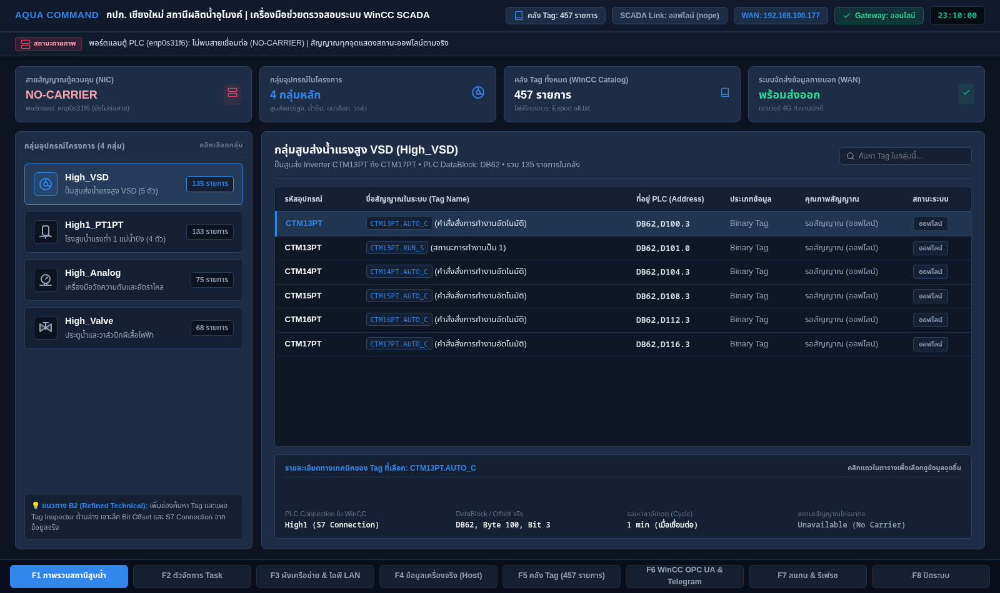
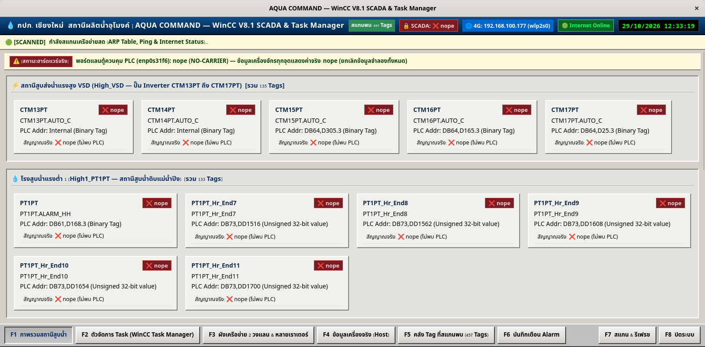
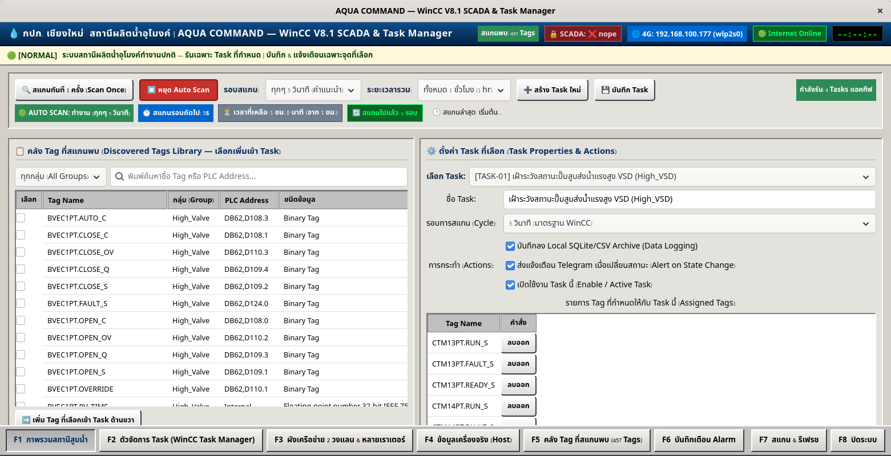
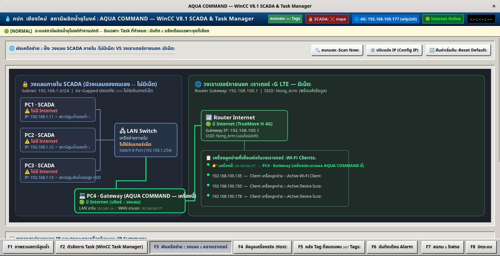
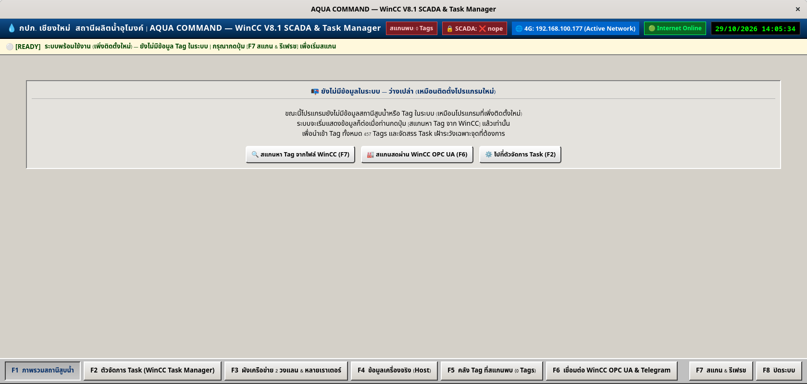
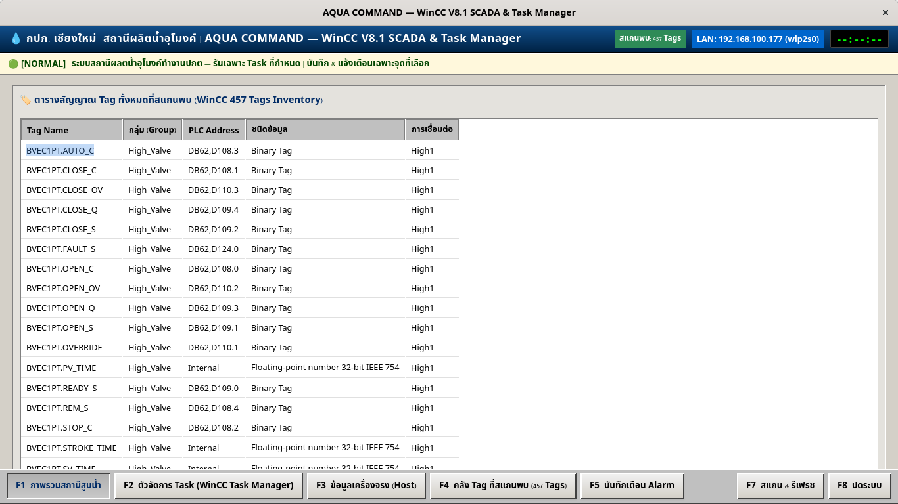
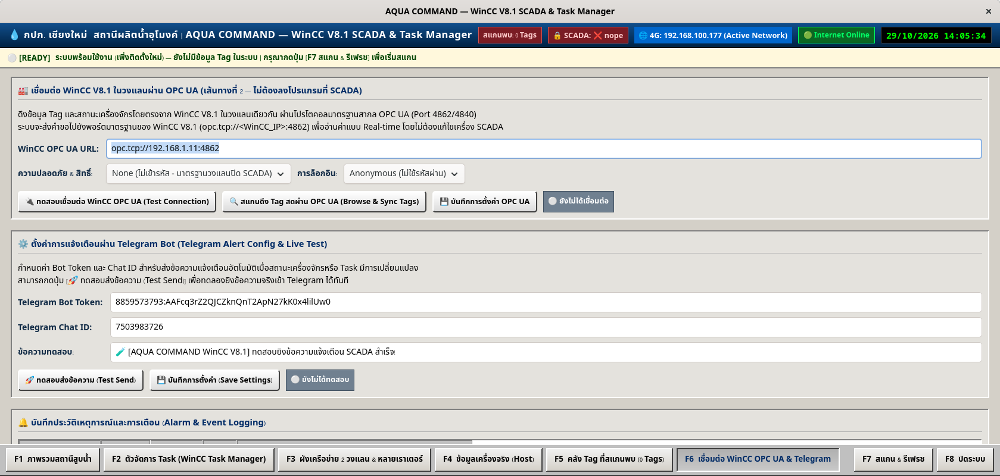

# AQUA COMMAND — WinCC V8.1 SCADA & Task Manager

ระบบบริหารจัดการและเฝ้าระวังสถานีผลิตน้ำอุโมงค์ (การประปาส่วนภูมิภาค เขต 9 / เชียงใหม่) ผสานการทำงานระหว่างระบบ **Siemens WinCC V8.1 SCADA**, **OPC UA**, **ระบบเครือข่าย 2 วงแลน (OT Closed LAN & IT 4G Gateway)** และระบบแจ้งเตือน **Telegram Incident Alerting**

---

## 🎨 F1 Overview — Station Explorer Redesign (Option B)

การออกแบบปรับปรุงส่วนติดต่อผู้ใช้ (UI/UX) หน้าแรก (F1 ภาพรวมสถานีสูบน้ำ) เป็นรูปแบบ **Master–Detail Station Explorer**:
* โครงสร้างเมนูมาตรฐานเดิมแบบ **Bottom Function Keys F1–F8** และ **Header สถานะระบบ**
* ชุดสี Cyber-Industrial Dark Theme ตามสัดส่วน **60/30/10** (Background `#0B1220`, Panels `#1C2D45`, Accent `#3186EA`)
* ใช้ SVG Icons แทนอีโมจิ คมชัดระดับอุตสาหกรรม
* แยกกลุ่มสถานีจริงจากโครงการ WinCC: `High_VSD`, `High1_PT1PT`, `High_Analog`, `High_Valve`, `High_DPM`

### ภาพจำลองการออกแบบใหม่ (Design Mockups)

#### แบบ B1 — Balanced Industrial (เรียบง่าย สบายตา สรุปกลุ่มสถานีและตารางรายละเอียด)


#### แบบ B2 — Refined Technical (เพิ่มช่องค้นหา Tag และแผง Tag Property Inspector Drawer)


* **ดูตัวอย่างความละเอียด 1920×1080 (Full HD):** [docs/mockups/preview_b2_1920x1080.png](docs/mockups/preview_b2_1920x1080.png)
* **ดูตัวอย่างความละเอียด 1366×768 (Laptop Standard):** [docs/mockups/preview_b2_1366x768.png](docs/mockups/preview_b2_1366x768.png)
* **เปิดหน้าต่างเว็บแกลเลอรีแบบ Interactive:** [docs/gallery/ดูแบบ_F1_MOCKUPS.html](docs/gallery/ดูแบบ_F1_MOCKUPS.html)

---

## 🖥️ ภาพหน้าจอจริงของโปรแกรม SCADA ปัจจุบัน (Current System Screens)

| หน้าจอ | คำอธิบาย | ภาพหน้าจอจริง |
| :--- | :--- | :--- |
| **F1 ภาพรวมสถานีสูบน้ำ** | แสดงกลุ่มสถานีสูบน้ำดิบ/น้ำแรงสูง พร้อมการ์ดแสดงสถานะอุปกรณ์รายตัว |  |
| **F2 ตัวจัดการ Task** | กำหนด Task เฝ้าระวังเฉพาะจุด ตั้งเวลารอบสแกนอัตโนมัติ (Auto-Scanner) |  |
| **F3 ผังเครือข่าย 2 วงแลน** | ตรวจสอบสถานะการเชื่อมต่อระหว่างวงแลนปิด SCADA (192.168.1.x) และเราเตอร์ 4G |  |
| **F4 ข้อมูลเครื่องจริง** | สเปกฮาร์ดแวร์, CPU Load, RAM, อุณหภูมิ, ดิสก์ และสถานะ NIC Interface |  |
| **F5 คลัง Tag ที่สแกนพบ** | รายการ Tag ทั้งหมด 457 Tags แยกตามหมวดหมู่ พร้อมฟิลเตอร์ค้นหา |  |
| **F6 เชื่อมต่อ OPC UA & Telegram** | ตั้งค่า Endpoint OPC UA Server และการแจ้งเตือนเหตุการณ์ผ่าน Telegram Bot |  |

---

## 🏗️ โครงสร้างเมนูและการควบคุม (Global F1–F8 Navigation)

| ปุ่มฟังก์ชัน | หน้าจอ | รายละเอียดการทำงาน |
| :---: | :--- | :--- |
| **F1** | ภาพรวมสถานีสูบน้ำ | สรุปสถานะปั๊มน้ำ, วาล์วไฟฟ้า, อัตราไหล และระดับน้ำ |
| **F2** | ตัวจัดการ Task | WinCC Task Manager รันเฉพาะงานที่ได้รับมอบหมาย ไม่รบกวน PLC ทั้งระบบ |
| **F3** | ผังเครือข่าย 2 วงแลน | แสดงเราเตอร์ 4G, Switch, IP Address และเวลา Ping ของแต่ละโหนด |
| **F4** | ข้อมูลเครื่องจริง (Host) | ตรวจสอบสุขภาพเครื่องคอมพิวเตอร์และพอร์ตแลน `enp0s31f6` |
| **F5** | คลัง Tag ที่สแกนพบ | ค้นหาและตรวจสอบ Offset, Data Block (DB60/61/62) ของแต่ละ Tag |
| **F6** | เชื่อมต่อ SCADA & Bot | บันทึก Log เหตุการณ์, กำหนด OPC UA Endpoint และทดสอบส่ง Telegram |
| **F7** | สแกน & รีเฟรช | ดึงข้อมูล Tag ล่าสุดจากไฟล์ WinCC หรือ OPC UA ทันที |
| **F8** | ปิดระบบ | บันทึกสถานะและปิดโปรแกรมอย่างปลอดภัย |

---

## 📂 เอกสารและรายงานการพัฒนา (Reports & Audits)

* 📄 [F1 Overview Visual Mockup Review](docs/reports/F1_OVERVIEW_VISUAL_MOCKUPS.md) — รายละเอียดการออกแบบ Option B1 และ B2
* 📄 [WinCC SCADA Mod Report](docs/reports/WINCC_SCADA_MOD_REPORT.md) — รายงานการทดสอบและสถาปัตยกรรมระบบ WinCC
* 📄 [Modern Interface Overhaul Report](docs/reports/MODERN_INTERFACE_OVERHAUL_REPORT.md) — แผนและเกณฑ์การปรับปรุง UI/UX
* 📊 [WinCC Tag Database (Export all.txt)](docs/tags/Export%20all.txt) — ฐานข้อมูล Tag จริง 457 รายการจากโครงการอุโมงค์

---

## 🚀 การติดตั้งและการเปิดใช้งาน

### บนระบบ Linux (Fedora / RHEL / Ubuntu)
```bash
# รันโปรแกรมผ่าน Python GTK4
python3 aqua-command-desktop/desktop/app.py
```

### บนระบบ Windows 11
```bash
# รันเวอร์ชัน Windows Portable
python aqua-command-desktop/desktop/win_desktop.py
```
*(หรือเปิดไฟล์ปฏิบัติการแบบ Standalone `AQUA_COMMAND_SCADA.exe`)*
