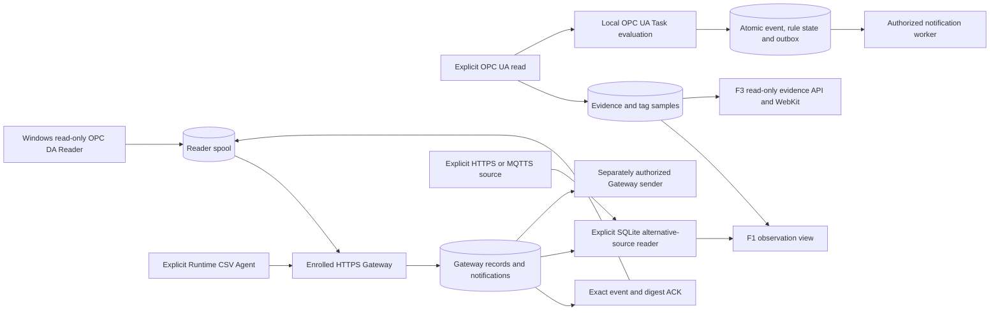

# Architecture and custody boundaries

The stores have distinct owners. The Gateway SQLite archive, local probe evidence, local Task storage and legacy web JSON snapshot are separate persistence domains. F3 reads its evidence contract and local host observations. It does not infer verified traffic from a configured address or Gateway ACK.

The local OPC UA Task path evaluates quality-bearing observations. A trigger commits the rule state, event and outbox together. Alternative OPC DA/REST/MQTT observations feed F1 and retain per-source timestamps. They do not currently feed that local Task engine. F3 still labels several internal Task/Outbox/notification monitoring capabilities as unavailable, even where a separately configured worker exists.

The Windows and CSV paths retain each source sequence and event ID until the enrolled Gateway acknowledges the matching digest. This acknowledges durable custody. A separate Telegram API response determines notification acceptance. A lost response leaves a held `delivery_unknown` record. An operator-requested resend can duplicate a previously accepted message.

The legacy web path stages alerts, notification jobs and rule state in one candidate snapshot, checks capacity, synchronizes the temporary file, atomically renames it and synchronizes the directory. A failure after rename has an explicit unknown-commit outcome and suspends dispatch. There is no overflow queue. Full storage returns backpressure to the producer, which must retain and retry its input.

Opening the desktop does not authorize a collector or external delivery. Capture, transfer, source configuration, certificate trust and notification permissions remain separate. LAB test evidence uses temporary profiles and isolated networking.
