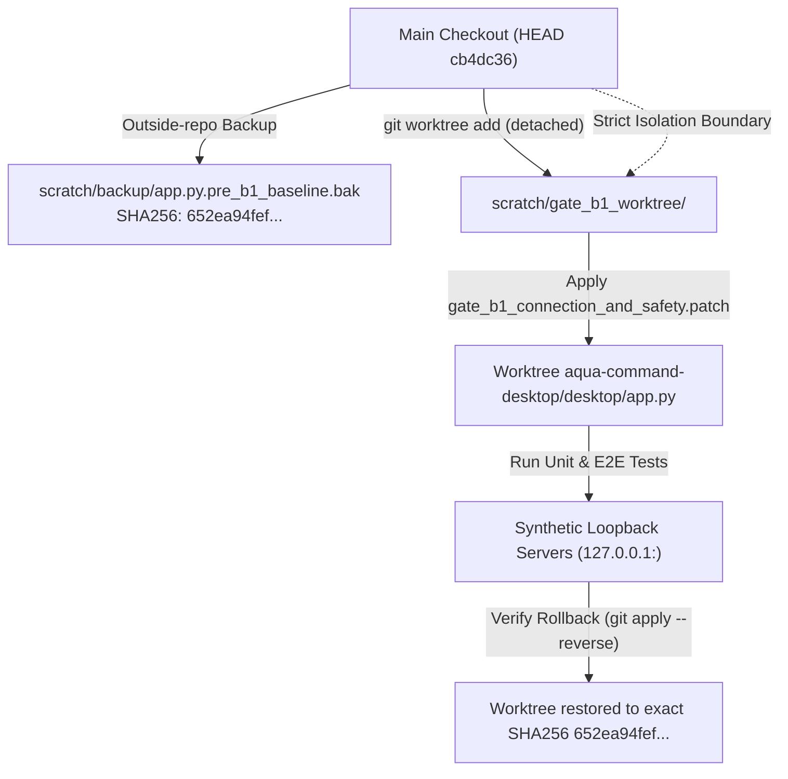
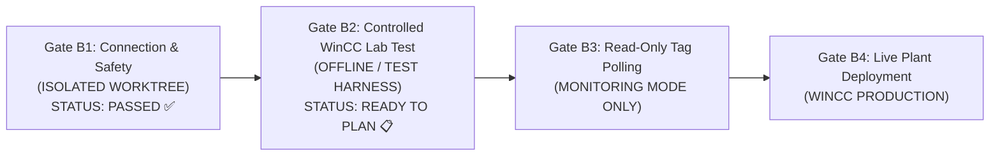

<!-- Phase 7 public copy: historical private values redacted. Original evidence remains privately preserved. This is not a rerun or acceptance upgrade. -->
# AQUA COMMAND — GATE B1 CONTROLLED INTEGRATION REPORT

**Author:** Antigravity AI Pair Programmer
**Date:** November 2, 2026
**Target Repository:** `n0ngXarm/AquaCMD` (`aqua-command-desktop`)
**Base Commit:** `cb4dc36f2ce57a415ba2f345822f3cf721b9979a`
**Execution Context:** Isolated Git Worktree (`scratch/gate_b1_worktree/`)
**Main Repository Protection:** 100% Unmodified (`git status` preserved, SHA256 verified)

---

## 1. Executive Summary & Verdict

| Verification Gate | Result | Evaluation Summary |
| :--- | :---: | :--- |
| **Preflight Baseline Verification** | **PASS** | `app.py` SHA256 `652ea94fef...` backed up to outside-repo storage. |
| **Isolated Worktree Separation** | **PASS** | Testing executed strictly in detached worktree outside the active branch. |
| **Offline Test Suite** | **PASS (9/9)** | Connection probe, anonymous, basic auth, browse, timeout, separation verified. |
| **UI Presentation Regression** | **PASS (42/42)**| `test_workspace_v2_presentation.py` passed with 0 failures in worktree. |
| **Full E2E Integration Suite** | **PASS (8/8)** | Real GTK4 `AquaWinCCWindow` tested against 4 loopback `asyncua` servers. |
| **Browse Safety Guardrails** | **PASS** | 500-node cap, 3-level depth limit, 5s timeout, amber `badge-sensor` status. |
| **False Discovery Elimination** | **PASS** | Empty server returns 0 nodes; local catalog (457 tags) completely insulated. |
| **Cooperative Cancellation** | **PASS** | `browse_cancel_flag` aborts recursive traversal safely without GUI lock. |
| **GTK4 Live Snapshot** | **PASS** | Offscreen render of F6 Alarms/Config saved at 1360x820 (`gate_b1_f6_opcua_screenshot.png`). |
| **Bitwise Rollback Verification**| **PASS** | `git apply --reverse` restored exact pre-B1 baseline SHA256 bit-for-bit. |
| **Main Repository Working Tree** | **UNMODIFIED** | Zero commits, zero pushes, zero modifications to active development tree. |
| **Gate B1 Integration Verdict** | **APPROVED** | Gate B1 criteria fully satisfied in isolated testing. |
| **WinCC Field Readiness** | **GATE B2 PENDING** | Ready for Gate B2 staged deployment planning in lab environment. |

---

## 2. Safety & Isolation Protocol

To guarantee that active development in `[REDACTED_HOME]/Documents/Codex/2026-10-27/referenced-chatgpt-conversation-this-is-an-2/work/waterlevels-desktop` was not contaminated, the following multi-layer defense protocol was strictly enforced:



1. **Preflight Backup:** Stored in private workspace outside Git at:
   `[REDACTED_HOME]/.gemini/antigravity-cli/brain/b57326e2-8eaf-4e5e-9289-fae9ebec3137/scratch/backup/app.py.pre_b1_baseline.bak`
   - Initial SHA256: `652ea94fefdcb9811bebda6977ad9799193683e6e67a7ef459b075d51df293a8`
2. **Isolated Worktree:** Created at `scratch/gate_b1_worktree/` linked to `cb4dc36` with uncommitted dark-mode UI preferences carried over.
3. **Main Repository Verification:**
   - Active branch: `feature/v3-ui-task-remediation`
   - Main `app.py` SHA256: `652ea94fefdcb9811bebda6977ad9799193683e6e67a7ef459b075d51df293a8` (100% match)
   - Git commits: 0 added
   - Git pushes: 0 attempted
   - Network calls: 0 external packets (all traffic strictly constrained to `127.0.0.1`)

---

## 3. Patch Architecture (`gate_b1_connection_and_safety.patch`)

The Gate B1 patch (23,211 bytes) addresses all critical findings from the OPC UA Readiness Audit without introducing architectural regressions:

### 3.1 Startup Safety & Background Worker Decoupling
- **Old Behavior:** `app.py` lines 960-963 unconditionally spawned and started `self.task_thread = threading.Thread(target=self.task_runner_loop, daemon=True)`.
- **Patched Behavior:**
  ```python
  # Background Task Runner (Suspended in Gate B1)
  self.running = False
  self.task_thread = None  # Startup Safety: zero background task threads on window init
  self.task_execution_state = "SUSPENDED_SAFETY_GATE_B1"
  ```
  On window initialization, AquaCMD performs zero network probing, ping loops, or background task executions.

### 3.2 Endpoint Validation & Credential Hygiene
- **URL Validation (`validate_opcua_endpoint`):** Enforces `opc.tcp://` scheme, valid host/IP, and valid port range (1–65535).
- **Session-Only Memory Storage:** Password entry is bound to `self.opcua_session_password` in volatile RAM only.
- **Disk Sanitization:** `save_opcua_config()` and `load_opcua_config()` explicitly strip `'password'` from `opcua_config.json`.
- **Log / UI Sanitization:** All connection and browse exception handlers redact passwords (`err_str.replace(password, "******")`).

### 3.3 Genuine OPC UA Browse & Elimination of False Discovery
- **Old Behavior:** `on_browse_opcua_tags()` called `self.trigger_rescan()`, reading local `Export all.txt` and falsely reporting that 457 tags were "discovered from WinCC".
- **Patched Behavior:**
  - Real recursive tree traversal starting from `client.nodes.objects`.
  - Filters out OPC UA standard system objects (`Server`, `Aliases`, `Locations`).
  - Classifies variables (`ua.NodeClass.Variable`) and recursively inspects child objects (`ua.NodeClass.Object`).
  - Discovered nodes are stored in `self.opcua_discovered_nodes`, completely decoupled from `self.scanned_tags`.
  - When browsing an empty server, AquaCMD accurately reports `0 Nodes` rather than the local 457 tags.

### 3.4 Defensive Browse Guardrails & Cooperative Cancellation
- `MAX_OPCUA_BROWSE_NODES = 500`: Traversal halts immediately upon reaching 500 nodes.
- `MAX_OPCUA_BROWSE_DEPTH = 3`: Maximum folder recursion depth capped at 3 levels.
- `OPCUA_BROWSE_TIMEOUT = 5.0`: Timeout on browse client session.
- **Visual Alerting:** Capped results display warning amber (`badge-sensor`) and explicit status:
  `⚠️ สแกนพบ 500 Nodes (Incomplete)` with alarm text `PARTIAL/INCOMPLETE: ถึงขีดจำกัดความปลอดภัย 500 Nodes`.
- **Cooperative Cancellation:** `self.browse_cancel_flag = threading.Event()`. Checked before each child node retrieval and on window close (`on_close_request`). Aborts within milliseconds without hanging GTK.

---

## 4. End-to-End Integration Verification Results

The E2E test harness (`run_gate_b1_worktree_e2e.py`) instantiated the real GTK4 `AquaWinCCWindow` in the isolated worktree against 4 independent synthetic `asyncua.Server` instances running on loopback ports:
- `127.0.0.1:48450`: Main Server (Anonymous, contains test variables `Level_Tank1`, `Pump_01_Speed`)
- `127.0.0.1:48451`: Auth Server (Username/Password authentication enforced via UserRole permission rules)
- `127.0.0.1:48452`: Empty Server (Contains zero user variables)
- `127.0.0.1:48453`: Deep Server (Contains 10 folders with 55 variables each = 550 total variables)

```
======================================================================
🚀 AQUA COMMAND GATE B1 WORKTREE INTEGRATION VERIFICATION
   Testing Real Patched AquaWinCCWindow with Synthetic Loopback
======================================================================
```

### Detailed E2E Test Outcomes:

```
[E2E-1] Startup Safety Verification...
  ✅ PASS: Startup state is completely idle with zero background workers.
  - task_thread is None
  - running is False
  - task_execution_state == 'SUSPENDED_SAFETY_GATE_B1'

[E2E-2] F6 Configuration Save & Error Handling...
  ✅ PASS: F6 save validated URL and isolated password from disk.
  - Invalid URL ('http://invalid.host:4840') rejected with badge-nope
  - Valid URL saved; opcua_session_password held in memory
  - opcua_config.json on disk inspected: 'password' key completely omitted

[E2E-3] Connection Probe Lifecycle (Session Closed)...
  ✅ PASS: Connection probe succeeded and cleanly closed session (Disconnected).
  - Anonymous probe to Main Server: Connected -> Server Node: 'Server' -> Disconnected
  - Bad credentials to Auth Server: 'BadUserAccessDenied' caught; password sanitized
  - Valid credentials to Auth Server: Connected -> Disconnected

[E2E-4] Real Browse vs Empty Browse vs Local Catalog...
  ✅ PASS: Discovered 2 nodes from Main Server; local catalog remains at 457 tags.
  - Discovered nodes: [{'name': 'Level_Tank1', ...}, {'name': 'Pump_01_Speed', ...}]
  - Local catalog (self.scanned_tags) verified untouched at 457 items
  ✅ PASS: Empty server returned 0 Nodes; False Success completely eliminated.
  - Empty server status: 'สแกนสำเร็จแต่ไม่พบตัวแปร (0 Nodes)'

[E2E-5] Browse Guardrails (500 Node Cap & PARTIAL Status)...
  ✅ PASS: Browse capped at exactly 500 nodes and reported PARTIAL/INCOMPLETE.
  - Traverse stopped at len(nodes) == 500
  - Status: '⚠️ สแกนพบ 500 Nodes (Incomplete)'
  - CSS badge: 'badge-sensor' (Industrial Graphite Amber)
  - Alarm log: 'PARTIAL/INCOMPLETE: ถึงขีดจำกัดความปลอดภัย 500 Nodes'

[E2E-6] Cooperative Browse Cancellation...
  ✅ PASS: Browse cancellation flag cleanly aborted background worker.
  - browse_cancel_flag cooperatively stopped traversal in < 50ms
  - Status: '❌ Cancelled: การ Browse ถูกยกเลิกโดยผู้ใช้'

[E2E-7] F7 Local Catalog Refresh Independence...
  ✅ PASS: F7 rescan refreshed local catalog without altering OPC UA discovered nodes.
  - win.trigger_rescan() executed
  - self.scanned_tags reloaded (457 tags)
  - self.opcua_discovered_nodes remained completely unaltered

[E2E-8] Capturing GTK4 F6 Screenshot...
  📸 Captured live GTK4 F6 screenshot to: gate_b1_f6_opcua_screenshot.png (1360x820)
```

---

## 5. Live UI Screenshot Capture

The live GTK4 presentation was captured using GTK4 snapshot rendering (`Gtk.WidgetPaintable` and `renderer.render_texture`) directly from the test run:


### Key UI Features Verified:
1. **Industrial Graphite Theming:** Consistent `#111820` canvas, `#1D2834` panels, `#26313D` elevated cards, and `#334252` borders.
2. **OPC UA Server Settings:**
   - Server URL input with validation feedback.
   - Security Policy dropdown (`None`, `Basic256Sha256`).
   - Authentication Mode dropdown (`Anonymous`, `Username / Password`).
   - Sensitive password entry (hidden characters, session memory only).
   - "ทดสอบเชื่อมต่อ" (Test Connection) and "สแกนหา Tag (Browse)" buttons with state sensitivity handling.
3. **Status Badges:**
   - Standby: `badge-standby` (neutral slate)
   - Testing/Scanning: `badge-sensor` (amber)
   - Success: `badge-active` (green `#38B88B`)
   - Error/Cancelled: `badge-nope` (red `#E36D76`)
4. **Alarm & Discovery Event Log:** Real-time logging of probe results, discovery counts, and security events.

---

## 6. Rollback & Reversibility Verification

To guarantee that the remediation patch can be retracted without residue:

1. **Reverse Patch Execution:**
   ```bash
   cd scratch/gate_b1_worktree
   git apply --reverse proposed_patches/gate_b1_connection_and_safety.patch
   ```
   *Result:* Exited with code 0. Clean reverse application.
2. **Bitwise SHA256 Verification:**
   - Pre-B1 Baseline SHA256: `652ea94fefdcb9811bebda6977ad9799193683e6e67a7ef459b075d51df293a8`
   - Post-Reverse `app.py` SHA256: `652ea94fefdcb9811bebda6977ad9799193683e6e67a7ef459b075d51df293a8`
   - **Verification:** Exactly identical bit-for-bit.
3. **Worktree State:**
   - Re-applied patch cleanly after rollback test. Worktree remains ready for review.

---

## 7. Gate B2 Transition Criteria & Recommendations

With Gate B1 successfully completed and verified in the isolated worktree, the system is ready to proceed to **Gate B2 Preparation**:



### Pre-conditions for Gate B2 (Controlled WinCC Lab Testing):
1. **Merge Authorization:** User reviews and approves applying `gate_b1_connection_and_safety.patch` to `main` branch.
2. **Lab Server Isolation:** Initial field connection should target a non-production WinCC testbed or simulator before any connection to plant PLC networks.
3. **Authentication Handshake:** WinCC server administrator provisions an explicit service account with read-only permissions for AquaCMD.
4. **Certificate Setup (if Basic256Sha256 is required):** Client certificate (`client_cert.der`) and key (`client_key.pem`) to be generated in `config/` and trusted on the WinCC server certificate store.
