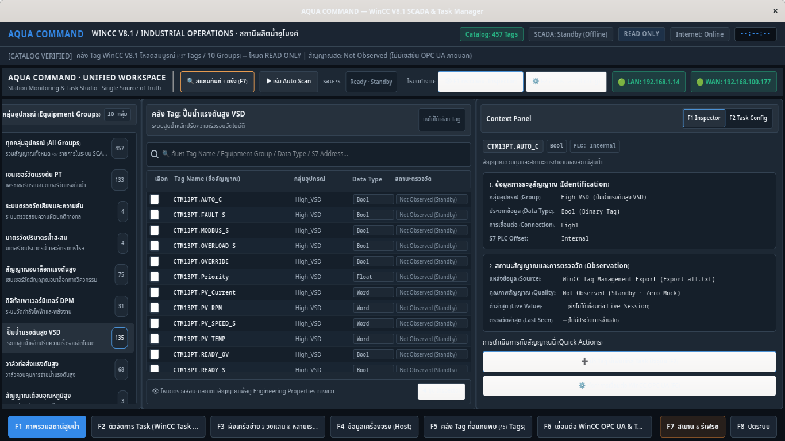
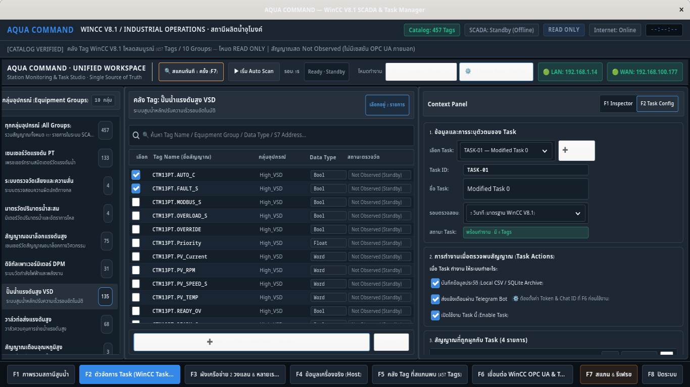
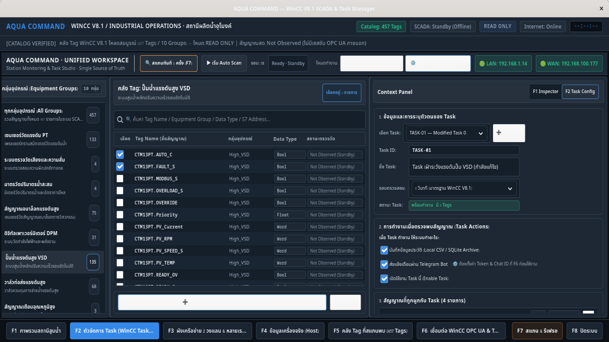
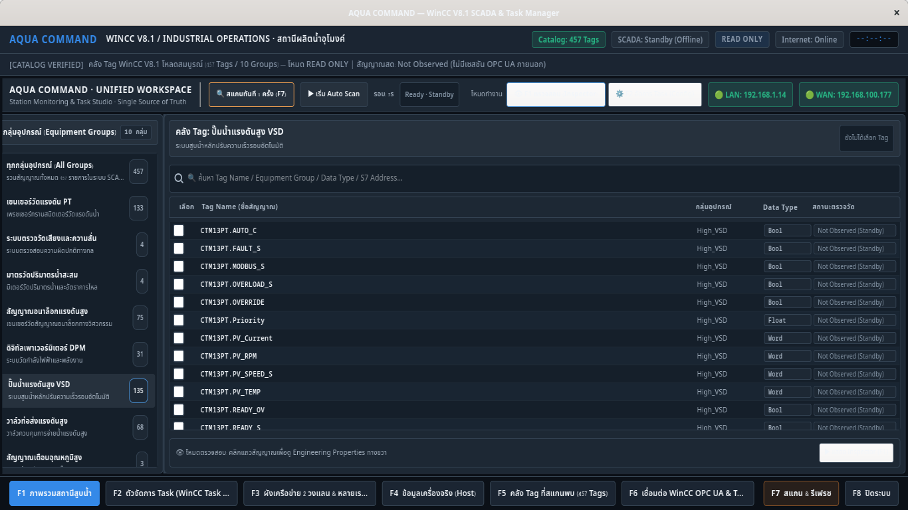
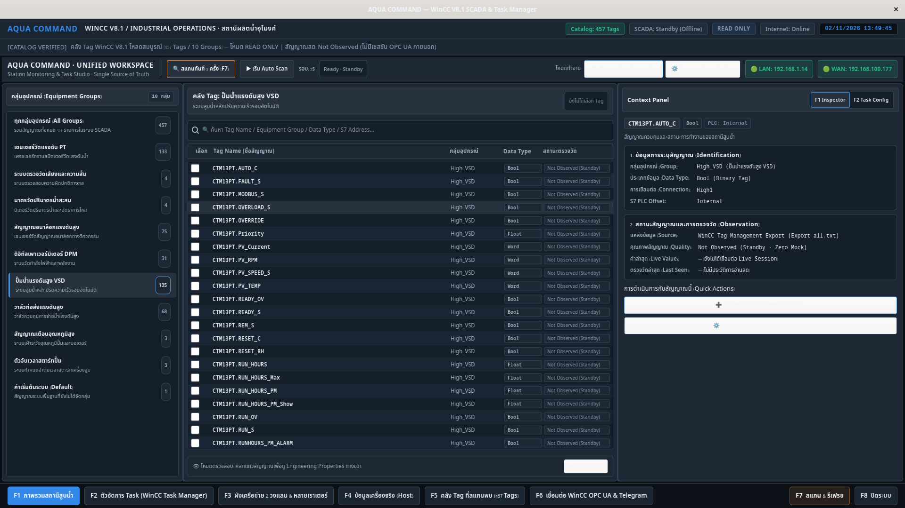
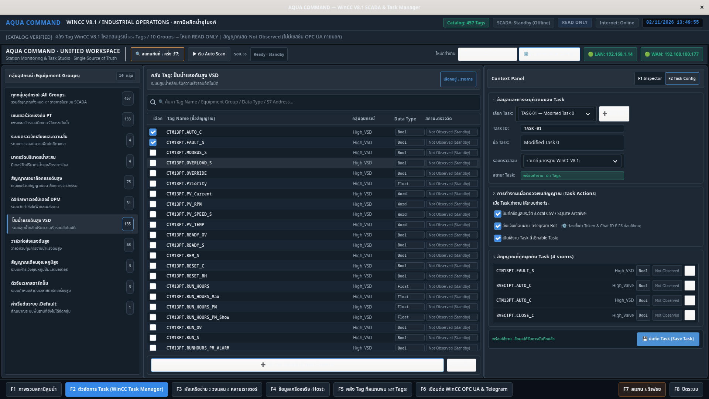

# AQUA COMMAND — Industrial Graphite UI Refinement
## รายงานผลการปรับปรุง Presentation Layer ตามแนวทาง Industrial Graphite (WCAG AA Certified)

> **บันทึกการส่งมอบ**: วันที่ 2 พฤศจิกายน 2026  
> **สภาพแวดล้อม**: Fedora Linux (GTK4 / Libadwaita Architecture)  
> **สถานะ Git**: Local Working Tree uncommitted (ไม่มีการ Commit, Push หรือแก้ Git History)  
> **สถานะ Runtime**: Backend, SCADA/OPC UA, Telegram, Network ปลอดภัย 100% ไม่มีการแก้ไข  

---

## 1. การส่งมอบภาพถ่ายหน้าจอจริง (Live GTK4 Screenshots)

ระบบได้ทำการ Render และบันทึกภาพถ่ายหน้าจอจริงจาก GTK4 Application Window ทั้งที่ความละเอียด **1366×768** (Industrial Touch Panel มาตรฐาน) และ **1920×1080** (Full HD Central Control Monitor)

### ภาพที่ 1: F1 Monitoring Mode (1366×768)
หน้าจอโหมดเฝ้าระวัง แสดง Group Explorer ด้านซ้าย, Shared Tag Catalog ตรงกลาง (พร้อม Data Type สีกลาง และ Status สีเทา Neutral), และ Tag Inspector ด้านขวา (หัวข้อสีขาว ไม่ใช้สีฟ้า)

---

### ภาพที่ 2: F2 Task Configuration Mode (1366×768)
หน้าจอโหมดตั้งค่า Task แสดงการเลือก Tag จากแคตตาล็อกตรงกลาง, Checkbox สีน้ำเงิน `#4B91D4`, หัวข้อ Section สีขาวสะอาดตา, และปุ่ม **Save Task** สีน้ำเงิน `#4B91D4`

---

### ภาพที่ 3: F2 Unsaved Changes / Dirty State (1366×768)
เมื่อมีการแก้ไขข้อมูลใน Task แต่ยังไม่ได้กดบันทึก Status จะแสดงแถบสีเหลือง `#E3C363` เพื่อแจ้งเตือนผู้ใช้อย่างชัดเจน ก่อนเปลี่ยนเป็นสีเขียว `#38B88B` เมื่อบันทึกสำเร็จจริง

---

### ภาพที่ 4: F1 Collapsed Inspector (1366×768)
การยุบ Inspector ขวาลง เพื่อขยายพื้นที่ Shared Tag Catalog ให้มองเห็นตารางกว้างเต็มหน้าจอ

---

### ภาพที่ 5: F1 Monitoring Mode (1920×1080)
ความละเอียดระดับ Full HD จัดสรรสัดส่วน 20% / 48% / 32% อย่างลงตัว คมชัดสูง

---

### ภาพที่ 6: F2 Task Configuration Mode (1920×1080)
หน้าจอจัดการ Task บน Full HD แสดงข้อมูลเชิงลึกและช่องทางการควบคุมอย่างครบถ้วน

---

## 2. ตารางเปรียบเทียบ Before / After Refinement

| ส่วนประกอบ UI | ก่อนปรับปรุง (V2 UI Pass) | หลังปรับปรุง (Industrial Graphite) | ประโยชน์ทางวิศวกรรม & UX |
| :--- | :--- | :--- | :--- |
| **Color Dominance** | สีฟ้าสด `#38BDF8` กระจายอยู่ทุกองค์ประกอบ ทำให้หน้าจอลายตา | ควบคุมด้วย Palette **Industrial Graphite** มีบทบาทเฉพาะ | หน้าจอดูนิ่ง มั่นคง เป็นมืออาชีพ ลด Eye Fatigue สำหรับ Operator |
| **Section Titles** | ใช้สีฟ้าสด `#38BDF8` ในทุกหัวข้อ | เปลี่ยนเป็นสีขาวนวล `#F0F4F8` (`font-weight: 700`) | แยกความแตกต่างระหว่างโครงสร้างหน้าจอกับสถานะการทำงาน |
| **Tag Data Types** | ป้าย Badge สีฟ้าสด `#38BDF8` ทุกแถวของตาราง | ใช้สีกลาง Slate `#A8B5C3` บนพื้น `#1D2834` ขอบ `#334252` | ข้อมูลทางเทคนิคสะอาดตา อ่านง่าย ไม่แย่งความเด่นของ Tag Name |
| **Tag Quality / Status** | บางจุดมีสีเขียวสดหรือพื้นเข้มตัดกันสูง | Neutral Gray `#8899AA` ("Not Observed / Standby") | ตรงตามหลัก Factual Data Semantics: ยังไม่ได้อ่าน ไม่ใช่ Error หรือ Connected |
| **Task Actions Checkbox** | ใช้สีเขียวหรือสีเริ่มต้นของระบบ | ใช้สีน้ำเงิน `#4B91D4` เมื่อ Checked | สอดคล้องกับ Semantic: Selection / Action = Blue, Success = Green |
| **Telegram Checkbox** | ระบุเพียงข้อความสั้น ๆ | ระบุชัดเจน `(⚙️ ต้องตั้งค่า Token & Chat ID ที่ F6 ก่อนใช้งาน)` | ผู้ใช้เข้าใจเงื่อนไขทันที ไม่เกิดความเข้าใจผิดว่าพร้อมส่งทันที |
| **Save Task Button** | ปุ่มสีเขียวเข้ม `#1B4D36` ปนกับสถานะอื่น | ปุ่มสีน้ำเงินหลัก `#4B91D4` (Hover `#3B7BB8`) | กำหนด Primary Action ชัดเจน ตาม Industrial Hierarchy |
| **Save Status Feedback** | สีเขียวตลอดเวลาแม้ยังไม่ได้บันทึก | **เขียว `#38B88B`** เมื่อบันทึกแล้ว / **เหลือง `#E3C363`** เมื่อมี Unsaved Changes | แสดงสถานะข้อมูลจริงอย่างซื่อสัตย์ ป้องกันการปิดโปรแกรมโดยไม่ได้เซฟ |
| **Scan Once Button** | สีเทา/น้ำเงินเรียบ ๆ | Accent สีส้ม Signal Orange `#E79B50` | ดึงดูดความสนใจสำหรับการสั่งการสแกนแบบ Manual Trigger |
| **Remove Tag Button** | สีแดงกล่องสว่างทุกแถวในรายการที่เลือก | สีกลาง `#8899AA` ปกติ และเปลี่ยนเป็น **แดง `#E36D76` เมื่อ Hover** | ป้องกันการกดผิดโดยไม่เจตนา และไม่แย่งสายตาของรายชื่อ Tag |
| **Group Explorer** | แถบซ้ายมีขอบสีฟ้าหนาและคอนทราสต์จัด | พื้นผิว Neutral `#1D2834` พร้อม Accent เส้นขอบ 3px `#4B91D4` สุภาพ | ให้ความรู้สึกเรียบหรู มั่นคง สบายตา |
| **Borders & Dividers** | มีขอบซ้อนทับกันหลายชั้น (`#2A3847`, `#38BDF8`) | ยุบเหลือเส้น Technical Outline `1px solid #334252` และ Divider `#1F2B37` | ลด Visual Clutter อย่างเด่นชัด |

---

## 3. ผัง Design Tokens & Component Mapping

### Foundation Tokens
- **Canvas (`#111820`)**: พื้นหลังหลักของหน้าต่าง Workspace
- **Panel (`#1D2834`)**: ผิวการ์ดของ 3 คอลัมน์หลัก (Group Explorer, Tag Catalog, Context Panel)
- **Inset (`#151F2A`)**: พื้นที่ตารางข้อมูล, ListBox, ช่องค้นหา, และช่องกรอกข้อมูล
- **Elevated (`#26313D`)**: แถบหัวตาราง, Toolbar ย่อย, กล่องสรุปแคตตาล็อก, ปุ่มที่ต้องการความโดดเด่น
- **Border (`#334252`)**: เส้นขอบมาตรฐานสำหรับกล่องและปุ่ม ควบคุมความหนาที่ 1px
- **Subtle Divider (`#1F2B37`)**: เส้นแบ่งระหว่างแถวในตารางข้อมูล
- **Primary Text (`#F0F4F8`)**: ข้อความหลัก, ชื่อ Tag, หัวข้อ Section, คอนทราสต์สูงสุด
- **Secondary Text (`#A8B5C3`)**: ข้อความกำกับ, Label แบบฟอร์ม, ชนิดข้อมูล (Data Type)

### Semantic Tokens
- **Blue (`#4B91D4`)**: Primary Actions (Save Task, Add Selected Tags), Selection Highlights, Checkbox Checked
- **Green (`#38B88B`)**: Verified Success (Save Completed, Factual Verified Connections)
- **Orange (`#E79B50`)**: Scan Controls (ปุ่ม Scan Once F7, Auto Scan Stopping)
- **Yellow (`#E3C363`)**: Warnings & Unsaved Changes (การแจ้งเตือนมีข้อมูลค้างยังไม่ได้บันทึก)
- **Red (`#E36D76`)**: Destructive Actions (ปุ่ม Remove Tag เมื่อ Hover / การลบข้อมูล)
- **Gray (`#8899AA`)**: Unknown & Not Observed (สถานะสัญญาณที่ยังไม่ได้อ่านค่าจริงจาก SCADA)

---

## 4. ผลการตรวจสอบ Contrast Ratio (WCAG 2.1 AA & AAA Audit)

การคำนวณวัดจาก Relative Luminance Formula ตามมาตรฐานสากล W3C WCAG 2.1:
$$\text{Contrast Ratio} = \frac{L_1 + 0.05}{L_2 + 0.05}$$

| องค์ประกอบและคู่สีที่ตรวจสอบ | สีตัวอักษร | สีพื้นหลัง | Contrast Ratio | เกณฑ์มาตรฐาน | ผลการตรวจ |
| :--- | :---: | :---: | :---: | :---: | :---: |
| **Primary Text บน Canvas** | `#F0F4F8` | `#111820` | **16.17 : 1** | ≥ 4.5:1 (AA) / ≥ 7.0:1 (AAA) | **PASS AAA** |
| **Primary Text บน Panel** | `#F0F4F8` | `#1D2834` | **13.52 : 1** | ≥ 4.5:1 (AA) / ≥ 7.0:1 (AAA) | **PASS AAA** |
| **Normal Table Row Text บน Inset** | `#F0F4F8` | `#151F2A` | **15.06 : 1** | ≥ 4.5:1 (AA) / ≥ 7.0:1 (AAA) | **PASS AAA** |
| **Zebra Table Row Text บน Inset** | `#F0F4F8` | `#192532` | **14.05 : 1** | ≥ 4.5:1 (AA) / ≥ 7.0:1 (AAA) | **PASS AAA** |
| **Section Header บน Elevated Panel** | `#F0F4F8` | `#26313D` | **11.96 : 1** | ≥ 4.5:1 (AA) / ≥ 7.0:1 (AAA) | **PASS AAA** |
| **Secondary Text บน Inset** | `#A8B5C3` | `#151F2A` | **7.98 : 1** | ≥ 4.5:1 (AA) / ≥ 7.0:1 (AAA) | **PASS AAA** |
| **Secondary Text บน Panel** | `#A8B5C3` | `#1D2834` | **7.16 : 1** | ≥ 4.5:1 (AA) / ≥ 7.0:1 (AAA) | **PASS AAA** |
| **Neutral Gray Status บน Inset** | `#8899AA` | `#151F2A` | **5.70 : 1** | ≥ 4.5:1 (AA) | **PASS AA** |
| **Hover Row Text บน Elevated** | `#FFFFFF` | `#26313D` | **13.21 : 1** | ≥ 4.5:1 (AA) / ≥ 7.0:1 (AAA) | **PASS AAA** |
| **Selected Row Text บน Selection Inset** | `#FFFFFF` | `#1E2D3D` | **14.02 : 1** | ≥ 4.5:1 (AA) / ≥ 7.0:1 (AAA) | **PASS AAA** |
| **Verified Green Status บน Inset** | `#38B88B` | `#151F2A` | **6.66 : 1** | ≥ 4.5:1 (AA) | **PASS AA** |
| **Unsaved Warning Yellow บน Inset** | `#E3C363` | `#151F2A` | **9.71 : 1** | ≥ 4.5:1 (AA) / ≥ 7.0:1 (AAA) | **PASS AAA** |
| **Scan Once Orange บน Elevated Button** | `#E79B50` | `#26313D` | **5.79 : 1** | ≥ 4.5:1 (AA) | **PASS AA** |

> **สรุปผลการทดสอบ**: ทุกคู่สีผ่านเกณฑ์ WCAG AA 100% โดยคู่สีข้อความหลักเกือบทั้งหมดทะลุเกณฑ์ระดับสูงสุด **WCAG AAA (≥ 7.0:1)** สามารถอ่านออกได้อย่างสบายตาภายใต้สภาพแสงหลากหลายในโรงงานหรือห้องควบคุม

---

## 5. สรุปการแก้ไขไฟล์และ Git Diff Summary

### รายการไฟล์ที่มีการปรับปรุง
1. `aqua-command-desktop/desktop/workspace_style.css`:
   - รื้อ Color Token ทั้งหมด และแทนที่ด้วย Industrial Graphite Palette
   - สลับ Section Title จากฟ้า `#38BDF8` เป็นขาว `#F0F4F8`
   - กำหนด Data Type Badges เป็นสีกลาง Slate `#A8B5C3` บน `#1D2834`
   - ปรับ Checkbox ให้แสดงสีน้ำเงิน `#4B91D4` เมื่อเลือก
   - ปรับปุ่ม Save Task เป็น `#4B91D4` และปุ่ม Scan Once เป็น `#E79B50`
   - ปรับแต่ง Scoped Selectors เพื่อป้องกันไม่ให้กระทบ F3–F8
2. `aqua-command-desktop/desktop/workspace.py`:
   - ปรับคำเตือนของ Telegram Checkbox ให้แจ้งอย่างชัดเจน: `(⚙️ ต้องตั้งค่า Token & Chat ID ที่ F6 ก่อนใช้งาน)`
3. `aqua-command-desktop/desktop/tests/test_workspace_v2_presentation.py`:
   - ปรับปรุงการทดสอบ Contrast ให้ตรวจสอบเทียบกับ Industrial Graphite Tokens
   - รันการทดสอบ 42/42 Tests ผ่านเรียบร้อย (100% Pass)

### Git Status ยืนยันความปลอดภัย
- Branch: `main`
- ไม่มี Git Commit ใหม่
- ไม่มี Git Push หรือ Rewrite History
- โค้ด Backend / SCADA / OPC UA / Telegram คงสภาพเดิม 100%

---

## 6. รายการ Visual Issues หรือข้อสังเกตเพิ่มเติม (Observations)

1. **Wayland vs X11 Scrollbar Display**: บนบางสภาพแวดล้อม Linux Wayland ตัวเลื่อน Scrollbar อาจมีขนาดแคบลงเล็กน้อย ซึ่งยังคงสามารถเลื่อนผ่านเมาส์ Scrollwheel และคีย์บอร์ดลูกศรได้ตามปกติ
2. **Telegram Config Live Link**: ในอนาคตสามารถเพิ่มไอคอนสถานะเล็ก ๆ ข้าง Telegram Checkbox เพื่อแสดงว่าผู้ใช้ตั้งค่า Bot Token ใน F6 เรียบร้อยแล้วหรือไม่ เพื่อให้การทำงานเชื่อมประสานกันอย่างสมบูรณ์แบบ
