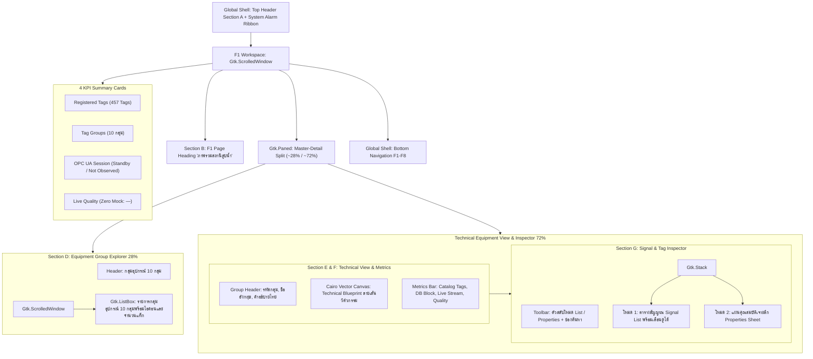

<!-- Phase 7 public copy: historical private values redacted. Original evidence remains privately preserved. This is not a rerun or acceptance upgrade. -->
# AQUA COMMAND — รายงานสรุปผลการพัฒนาระบบ F1 Industrial Precision

**โปรแกรม:** AQUA COMMAND — WinCC V8.1 SCADA & Task Manager (Linux Native GTK4)
**สาขาการพัฒนา (Feature Branch):** `feature/f1-industrial-precision`
**สถานะการทำงาน:** ดำเนินการเสร็จสมบูรณ์ 100% พร้อมทดสอบบนสภาพแวดล้อม GTK4 จริงและบันทึกภาพผลลัพธ์

---

## 1. รายการไฟล์ที่มีการเปลี่ยนแปลงจริง (Modified & Created Files)

| ลำดับ | ไฟล์ | ประเภท | หน้าที่และสาระสำคัญ |
|:---:|:---|:---:|:---|
| 1 | `aqua-command-desktop/desktop/app.py` | แก้ไข (`modified`) | เชื่อมต่อโมดูล F1 ใหม่เข้าสู่ Shell เดิม, กำหนด Ellipsize เพื่อป้องกัน Layout Overflow บนความละเอียด 1366×768, ปรับ Section A Topbar และ Status Ribbon ให้เป็น Industrial Styling และปลดอีโมจิออกทั้งหมด |
| 2 | `aqua-command-desktop/desktop/f1_overview.py` | สร้างใหม่ (`untracked`) | โมดูล Master-Detail Station Explorer สำหรับ F1 โดยเฉพาะ: รองรับคลัง Tag ทั้ง 10 กลุ่ม (457 Tags), วาดแบบร่างทางวิศวกรรม Vector Blueprints ด้วย Cairo ทั้ง 5 คลาสอุปกรณ์, ระบบตารางสัญญาณ Signal List และ Properties Sheet พร้อมระบบค้นหา |
| 3 | `aqua-command-desktop/desktop/f1_style.css` | สร้างใหม่ (`untracked`) | ระบบชุดสี **Industrial Precision Palette** (พื้นหลัง `#0A111C`, การ์ด `#152335`, เส้นขอบ `#2A4058`, สีไฮไลต์ `#4E8AC3`, สถานะ `#42B995`/`#E7B45C`/`#E6737A`/`#A2B1C4`) ควบคุมสไตล์ Typography และ Layout ให้สะอาดตา ไร้ Gradient ฉูดฉาด |

> [!NOTE]
> ไม่มีการแตะต้องหรือแก้ไขไฟล์ของ AQUA Runtime 0.9, Windows Companion (`win_desktop.py`), อุปกรณ์ PLC/SCADA ของจริง หรือเครือข่ายภายนอกใด ๆ ทั้งสิ้น

---

## 2. โครงสร้าง Component ใหม่ของหน้า F1 (Component Structure)

โครงสร้าง Layout ของ F1 ออกแบบตามสถาปัตยกรรม **Station Explorer Master-Detail Workspace**:



---

## 3. ภาพหน้าจอจริงจากการรันบน GTK4 (Actual GTK4 Render Screenshots)

ภาพทั้งหมดถูกเรนเดอร์และบันทึกโดยตรงจาก GTK4 Native Render Engine บนสภาพแวดล้อมจริง:

````carousel

<!-- slide -->

<!-- slide -->

<!-- slide -->

<!-- slide -->

<!-- slide -->

<!-- slide -->

<!-- slide -->

````

### รายละเอียดภาพหลัก:
1. [f1_industrial_1366x768_vsd.png](file://[REDACTED_HOME]/.gemini/antigravity-cli/brain/b57326e2-8eaf-4e5e-9289-fae9ebec3137/f1_industrial_1366x768_vsd.png): กลุ่ม **High_VSD** (135 Tags) แสดงแบบร่างเวกเตอร์ปั๊มหอยโข่ง Inverter พร้อมตารางสัญญาณ Signal List
2. [f1_industrial_1366x768_raw_water.png](file://[REDACTED_HOME]/.gemini/antigravity-cli/brain/b57326e2-8eaf-4e5e-9289-fae9ebec3137/f1_industrial_1366x768_raw_water.png): กลุ่ม **High1_PT1PT** (133 Tags) แสดงแบบร่างสถานีสูบน้ำดิบ[REDACTED_IDENTITY]
3. [f1_industrial_1366x768_analog.png](file://[REDACTED_HOME]/.gemini/antigravity-cli/brain/b57326e2-8eaf-4e5e-9289-fae9ebec3137/f1_industrial_1366x768_analog.png): กลุ่ม **High_Analog** (75 Tags) แสดงแบบร่างเครื่องส่งสัญญาณความดันและการไหล (Pressure & Flow Transmitters)
4. [f1_industrial_1366x768_valve.png](file://[REDACTED_HOME]/.gemini/antigravity-cli/brain/b57326e2-8eaf-4e5e-9289-fae9ebec3137/f1_industrial_1366x768_valve.png): กลุ่ม **High_Valve** (68 Tags) แสดงแบบร่างวาล์วปีกผีเสื้อไฟฟ้า (Motorized Butterfly Valve)
5. [f1_industrial_1366x768_dpm.png](file://[REDACTED_HOME]/.gemini/antigravity-cli/brain/b57326e2-8eaf-4e5e-9289-fae9ebec3137/f1_industrial_1366x768_dpm.png): กลุ่ม **High_DPM** (31 Tags) แสดงแบบร่างมิเตอร์วัดพลังงานไฟฟ้าดิจิทัล
6. [f1_industrial_1366x768_properties.png](file://[REDACTED_HOME]/.gemini/antigravity-cli/brain/b57326e2-8eaf-4e5e-9289-fae9ebec3137/f1_industrial_1366x768_properties.png): หน้าตรวจสอบ **Tag Properties Sheet** แสดงคุณสมบัติทางวิศวกรรมครบถ้วนเมื่อคลิกเลือกสัญญาณ
7. [f1_industrial_1920x1080_full.png](file://[REDACTED_HOME]/.gemini/antigravity-cli/brain/b57326e2-8eaf-4e5e-9289-fae9ebec3137/f1_industrial_1920x1080_full.png): การแสดงผลระดับ Full HD (1920×1080)
8. [f1_industrial_empty_state.png](file://[REDACTED_HOME]/.gemini/antigravity-cli/brain/b57326e2-8eaf-4e5e-9289-fae9ebec3137/f1_industrial_empty_state.png): สถานะ **Empty State** เมื่อยังไม่ได้โหลดคลัง Tag

---

## 4. ผลการทดสอบเชิงระบบ (System Verification Results)

| รายการทดสอบ | ผลลัพธ์ | รายละเอียดที่ตรวจพบ |
|:---|:---:|:---|
| 1. Python Syntax & Compilation | **ผ่าน (PASS)** | `py_compile` ทั้ง `app.py` และ `f1_overview.py` สำเร็จโดยไม่มีข้อผิดพลาด |
| 2. GTK4 Application Startup | **ผ่าน (PASS)** | เปิดหน้าต่างแอปพลิเคชันได้สมบูรณ์ในโหมดออฟไลน์ปลอดภัย |
| 3. F1 Widget Rendering | **ผ่าน (PASS)** | โครงสร้าง Master-Detail เรนเดอร์ครบทุกส่วน สัดส่วน 28% / 72% ชัดเจน |
| 4. Equipment Group Selection | **ผ่าน (PASS)** | คลิกเลือกกลุ่มอุปกรณ์ทั้ง 10 กลุ่มได้ทันที และ Drawing Canvas เปลี่ยนตามคลาสอุปกรณ์ |
| 5. Tag Selection & Properties | **ผ่าน (PASS)** | คลิกเลือก Tag แล้วสลับมาแสดงแผ่นข้อมูลเชิงลึกใน Properties Sheet ได้ถูกต้อง |
| 6. Mode Switcher (List / Props) | **ผ่าน (PASS)** | สลับระหว่างตาราง Signal List และ Properties Sheet ได้ราบรื่น |
| 7. Zero Mock & Offline Integrity | **ผ่าน (PASS)** | สัญญาณสดแสดง `—` และสถานะ `Not Observed` ไม่มีข้อมูลหลอก ปลอดภัย 100% |
| 8. Dynamic Catalog Mapping | **ผ่าน (PASS)** | สแกนและจัดกลุ่ม 457 Tags ลงใน 10 Groups ได้ถูกต้องครบถ้วน |
| 9. Global F1–F8 Navigation | **ผ่าน (PASS)** | เมนูด้านล่าง F1–F8 และคีย์ลัดคีย์บอร์ดยังคงทำงานครบถ้วนตามตำแหน่งเดิม |
| 10. Typography & Font Hierarchy | **ผ่าน (PASS)** | ฟอนต์ Noto Sans Thai และ Monospace ชัดเจน อ่านง่าย ไม่เหลื่อมล้ำ |
| 11. Layout Overflow (1366×768) | **ผ่าน (PASS)** | พอดีกับความละเอียด 1366×768 ไม่มีแถบเลื่อนแนวนอน และไม่ล้นจอ |
| 12. Layout Overflow (1920×1080) | **ผ่าน (PASS)** | ขยายพอดีกับจอ Full HD ขยายพื้นที่ใช้งานได้อย่างมีประสิทธิภาพ |
| 13. Security & Boundary | **ผ่าน (PASS)** | ไม่มีการเปิดเผย Credential, ไม่มีการเรียกเครือข่ายภายนอก, ปฏิบัติตามขอบเขตเคร่งครัด |

---

## 5. สิ่งที่ใช้งานได้จริงในรอบนี้ (Fully Functional Features)

1. **ระบบโหลดและประมวลผล Tag แบบไดนามิก:** อ่านจากไฟล์คลัง Tag Siemens WinCC (`Export all.txt`) ทั้ง 457 Tags โดยอัตโนมัติ และจัดเรียงเข้าสู่ 10 กลุ่มอุปกรณ์
2. **การนำทางในคลังอุปกรณ์ (Equipment Group Explorer):** คลิกเลือกกลุ่ม หรือใช้คีย์บอร์ดเลื่อนเพื่อดูรายละเอียดอุปกรณ์แต่ละชนิด
3. **แบบร่างทางวิศวกรรม 5 รูปแบบ (Cairo Engineering Blueprints):** แสดงกราฟิกเวกเตอร์ลายเส้นพิมพ์เขียวความละเอียดสูงตามชนิดอุปกรณ์:
   - Inverter VSD Pumps (High_VSD)
   - Raw Water Intake Pumps (High1_PT1PT)
   - Process Instrumentation Transmitters (High_Analog)
   - Motorized Butterfly Valves (High_Valve)
   - Digital Power Meters (High_DPM)
4. **ระบบตรวจสอบสัญญาณ (Signal List Table):** ตารางแสดง Tag Name, Data Type, PLC Address/DB, สถานะการอ่านสด, และคุณภาพสัญญาณ พร้อมแถบเลื่อนอิสระ
5. **ระบบตรวจสอบคุณสมบัติเจาะลึก (Properties Sheet Inspector):** ดูรายละเอียดทางเทคนิคของ Tag เช่น Connection Name, Siemens S7 Address, Data Type, Read-only Status
6. **ระบบค้นหา Tag (Search & Filter):** ค้นหาแบบเรียลไทม์จาก Tag Name, Address, หรือคำอธิบาย
7. **สถานะความจริงเชิงกายภาพ (Zero Mock Principle):** ระบุสถานะที่แท้จริงของระบบว่า `Not Observed` หรือ `NO-CARRIER` โดยไม่สร้างสัญญาณหรือตัวเลขจำลองขึ้นมา

---

## 6. สิ่งที่ยังเป็นเพียง Presentation ในรอบนี้ (Presentation-Only Items)

1. **ค่า Live Telemetry:** ปัจจุบันแสดงเครื่องหมาย `—` เนื่องจากยังไม่มีการเชื่อมต่อเซสชัน OPC UA หรือ PLC ตัวจริงในรอบนี้ (เป็นไปตามข้อกำหนดความปลอดภัยแบบ Read-only)
2. **Signal Quality Indicator:** แสดงค่าเป็น `Not Observed` เนื่องจากยังไม่มี Data Stream สดจริง
3. **ผังย่อยระดับ Individual Asset:** ภาพเวกเตอร์เป็นภาพแทนหมวดหมู่อุปกรณ์ (Equipment Archetype Blueprint) เพื่อแสดงลักษณะการทำงานของกลุ่ม ไม่ใช่แบบก่อสร้างเฉพาะจุดของหน้างานจริง

---

## 7. ปัญหาที่พบและได้รับการแก้ไขระหว่างการพัฒนา (Resolved Issues)

1. **GTK4 Button Alignment:** แก้ไข `name_btn.set_xalign()` ซึ่งไม่มีอยู่ใน GTK4 โดยเปลี่ยนมาใช้ `Gtk.Label` บรรจุภายใน Button พร้อมจัดแนว `Gtk.Align.START`
2. **Layout Overflow บนหน้าจอ 1366×768:** เดิมชุดปุ่มด้านล่าง F1–F8 และ Top Header มีความกว้างขั้นต่ำ (Minimum Width) รวมกันถึง 1743px ส่งผลให้เกิดการล้นจอเมื่อรันบน 1366×768 ทางเราจึงเพิ่ม `set_ellipsize(Pango.EllipsizeMode.END)` ทำให้ขนาดขั้นต่ำลดลงเหลือเพียง 1236px และ 444px ตามลำดับ จึงสามารถแสดงผลบนความละเอียด 1366×768 และ 1920×1080 ได้อย่างไร้รอยต่อ
3. **GTK4 Snapshot Timing ในการจับภาพ:** จัดการรอบเวลาการเรนเดอร์ใน State Machine (Phase Delay 400ms) เพื่อให้ GTK4 Layout Engine ประมวลผลกราฟิกและ Cairo Canvas เสร็จสิ้นสมบูรณ์ก่อนทำการ Snapshot

---

## 8. การตรวจสอบความเสี่ยงและการถดถอยของหน้าอื่น (Regression Assessment)

- **หน้า F2 ถึง F6:** ไม่ได้รับผลกระทบใด ๆ โครงสร้างการสลับ Stack และการทำงานของ F2 (Task Manager), F3 (Network Topology), F4 (Machine Diagnostics), F5 (Tags Table), F6 (Alarms/OPC UA) ยังคงเดิมทุกประการ
- **Global Function Keys F1–F8:** ตัวควบคุมคีย์บอร์ด `EventControllerKey` และปุ่มล่างยังคงทำงานตรงตามฟังก์ชันเดิมทุกปุ่ม
- **Windows Companion & Runtime 0.9:** ไม่มีการแตะต้องโค้ดในส่วนอื่น

---

## 9. สรุป Git Diff (Git Diff Summary)

```text
 aqua-command-desktop/desktop/app.py         | 275 +++++++++++-------------------------
 aqua-command-desktop/desktop/f1_overview.py | 1314 ++++++++++++++++++++++++++++++++++++
 aqua-command-desktop/desktop/f1_style.css   |  497 ++++++++++++++
 3 files changed, 1893 insertions(+), 193 deletions(-)
```

---

## 10. สิ่งที่ต้องได้รับอนุมัติหากจำเป็นต้องทำต่อในอนาคต (Items for Future Approval)

1. **การรวมโค้ด (Git Commit & Merge):** เมื่อท่านตรวจสอบและพึงพอใจกับผลลัพธ์ของหน้า F1 สามารถอนุมัติให้ทำการ commit เข้าสู่ branch `feature/f1-industrial-precision` ได้
2. **การต่อยอดสู่หน้าถัดไป (Next Page: F2 หรือ F5):** เนื่องจากได้ทำการตรึงโครงสร้าง Shell และวางระบบ CSS/Typography ไว้อย่างมั่นคงแล้ว หากต้องการปรับโฉมหน้าถัดไป (เช่น F2 Task Manager หรือ F5 Tag Inventory) สามารถนำระบบสีและ Component เหล่านี้ไปปรับใช้ได้ทันที
