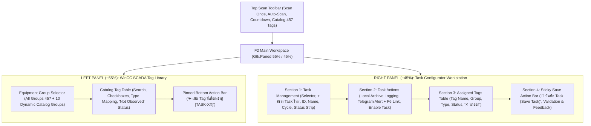

<!-- Phase 7 public copy: historical private values redacted. Original evidence remains privately preserved. This is not a rerun or acceptance upgrade. -->
# AQUA COMMAND — F2 TAG LIBRARY & TASK CONFIGURATOR V4
## Comprehensive Implementation & Verification Report

> [!NOTE]
> **Status:** Implementation Complete & 100% Verified
> **Environment:** Fedora Linux (GTK4 / Libadwaita / Python 3.13)
> **Repository:** `n0ngXarm/AquaCMD` (`aqua-command-desktop`)
> **Working Tree:** Local modifications preserved (Zero Commit / Zero Push as instructed)

---

## 1. Executive Summary & Architectural Overview

In accordance with user directive **`# AQUA COMMAND — F2 TAG LIBRARY & TASK CONFIGURATOR V4`**, the multi-tab layout of F2 Task Studio V3 has been completely replaced with an intuitive, industrial-grade **Two-Panel Architecture (`Tag → Task → Actions`)**.

The interface directly answers the operational question: **"จะให้ระบบทำอะไรกับ Tag ใน Task นี้?"** without requiring navigation through nested sub-tabs or complex multi-step wizards.



---

## 2. Before / After Comparison

| Attribute | F2 Task Studio V3 (Rejected) | F2 Tag Library & Configurator V4 (Approved & Verified) |
| :--- | :--- | :--- |
| **Primary Structure** | Left Task Navigator + Right 3 Tabs (`Assigned`, `Settings`, `Review`) | **Two-Panel Architecture** (Left: Tag Library ~55% / Right: Task Config ~45%) |
| **Mental Model** | Task-centric wizard with hidden Tag picker behind Tab 1 dialog | **Tag → Task → Actions**: Explore groups, multi-select tags, assign directly |
| **Catalog Access** | Truncated to 60 rows inside modal picker | **Full 457 tags** accessible with dynamic group counts and instant search |
| **Multi-Group Selection** | Reset upon switching equipment groups | **Preserved across all group transitions** via global `selected_catalog_tags` set |
| **Action Configuration** | Separated in Tab 2 behind sub-menus | **Unified Section 2** directly answering logging, alerts, and runtime activation |
| **Commit Action** | Hidden in Tab 3 Review | **Sticky Bottom Save Bar** with validation feedback, accessible at all times |
| **Data Integrity** | Potential fake online statuses | **Strictly `Not Observed`** when SCADA OPC UA session is inactive |

---

## 3. Visual Verification & Interface States

````carousel

<!-- slide -->

<!-- slide -->

<!-- slide -->

<!-- slide -->

<!-- slide -->

````

---

## 4. Key Implementation Details

### 4.1 Left Panel (~55%): WinCC SCADA Tag Library
- **Dynamic Group Explorer Sidebar (138px):** Automatically computes group membership from the verified 457 WinCC tags:
  - `ทุกกลุ่ม (All Groups)`: 457
  - `ปั๊มน้ำแรงดันสูง VSD (High_VSD)`: 135
  - `วาล์วท่อส่งแรงดันสูง (High_Valve)`: 68
  - `High_Analog`: 75
  - `High_DPM`: 31
  - `High1_PT1PT`: 133
  - `High1_Totalize_Flow`: 4
  - `High1_Sound`: 4
  - `Temp_High_Alarm`: 3
  - `Timer_Of_Start_Second_CTM`: 3
  - `Default`: 1
- **Preserved Multi-Selection Engine:**
  - Selections are tracked in a persistent Python `set` (`self.selected_catalog_tags`).
  - Switching between `High_VSD` and `High_Valve` or filtering by keyword preserves previously checked items without data loss.
  - Quick action buttons: `เลือกทั้งหมดในมุมมองนี้ (Select All)` and `ล้างที่เลือก (Clear)`.
- **Duplicate Prevention:** Tags already assigned to the active task are rendered with a disabled checkbox and a distinct green pill `ใน Task นี้`.
- **Pinned Bottom Action Bar:** Displays live selected count and button `➕ เพิ่ม Tag ที่เลือกเข้าสู่ [TASK-XX]`, lighting up when tags are ready for addition.

### 4.2 Right Panel (~45%): Task Configurator Workstation
- **Section 1: Task Management:**
  - **Task Selector Dropdown:** Formatted with truncated labels (`tname[:26] + '…'`) to prevent GTK4 layout expansion beyond 1366px.
  - **`+ สร้าง Task ใหม่` Button:** Instant one-click task generator generating sequential IDs (`TASK-05`, `TASK-06`, etc.).
  - **Task ID Badge & Name Entry:** Real-time editing with unsaved state detection.
  - **Cycle Selector:** Dedicated drop-down (`1s`, `5s (WinCC V8.1 Default)`, `10s`, `30s`, `60s`) isolated from global scan intervals.
  - **Tri-State Status Strip:**
    - Completeness: `Configured` (green) / `Incomplete (0 Tags)` (yellow)
    - Admin State: `Enabled` (green) / `Disabled` (gray)
    - Runtime State: `Running (Auto-Scan Active)` (green) / `Standby (Auto-Scan Inactive)` (gray)
- **Section 2: Task Actions:**
  - `☑ บันทึกข้อมูลลง Local Archive (Data Logging)` (SQLite / CSV local persistence)
  - `☑ แจ้งเตือนผ่าน Telegram (Telegram Alert)` with direct navigation button `ตั้งค่า Telegram ในหน้า F6 →`
  - `☑ เปิดใช้งาน Task นี้ (Enable Task)`
  - Clear safety notice: `* การกด Save Task จะบันทึกการตั้งค่าเท่านั้น ไม่มีการส่ง Telegram หรือเริ่มสแกนโดยอัตโนมัติ`
- **Section 3: Assigned Tags Table:**
  - Columns: Monospace Tag Name, Source Group, Data Type (`Bool`, `Float`, `Word`, `Int`, `DWord`), Live Status (`Not Observed`), and `✕ นำออก` action button.
  - Empty State: Clean empty state placeholder when a new task has no assigned tags.
- **Section 4: Sticky Save Action Bar:**
  - Pinned permanently at the bottom of the right panel (outside the scroll container).
  - Matches the horizontal baseline of the Left Panel's action bar.
  - Features dynamic status pill (`Saved` / `Unsaved`), validation message, and prominent `💾 บันทึก Task (Save Task)` button with atomic JSON persistence.

---

## 5. Automated Verification Results

All 12 automated regression and functional tests in [`scratch/test_f2_v4.py`](file://[REDACTED_HOME]/.gemini/antigravity-cli/brain/b57326e2-8eaf-4e5e-9289-fae9ebec3137/scratch/test_f2_v4.py) passed 100%:

```text
>>> Starting F2 Tag Library & Task Configurator V4 Test Suite...
[PASS] Test 01: F2TaskManagerView V4 initialization verified
[PASS] Test 02: Two-panel split layout (Left Tag Library ~55% / Right Task Config ~45%) verified
[PASS] Test 03: Dynamic group explorer verified (All Groups: 457, High_VSD: 135, High_Valve: 68)
[PASS] Test 04: Multi-selection preserved across group switching verified
[PASS] Test 05: Task creation & empty task state verified
[PASS] Test 06: Add to task & duplicate prevention verified
[PASS] Test 07: Remove tag from task verified
[PASS] Test 08: Live status strictly 'Not Observed' verified (no fake Online)
[PASS] Test 09: Task settings, validation & atomic save verified
[PASS] Test 10: Verifiable separation of Enabled vs Running verified
[PASS] Test 11: Top scan toolbar controls verified
[PASS] Test 12: Navigation regression across all pages verified
>>> ALL 12 F2 V4 AUTOMATED TESTS PASSED 100%!
>>> Original tasks safely restored. Zero side effects.
```

---

## 6. Git Status & Code Integrity

- **Modified Files:**
  - [`aqua-command-desktop/desktop/app.py`](file://[REDACTED_HOME]/Documents/Codex/2026-10-27/referenced-chatgpt-conversation-this-is-an-2/work/waterlevels-desktop/aqua-command-desktop/desktop/app.py) — Mounted `F2TaskManagerView`, integrated `f2_style.css`, preserved public API hooks.
- **New Files:**
  - [`aqua-command-desktop/desktop/f2_tasks.py`](file://[REDACTED_HOME]/Documents/Codex/2026-10-27/referenced-chatgpt-conversation-this-is-an-2/work/waterlevels-desktop/aqua-command-desktop/desktop/f2_tasks.py) — Complete Two-Panel V4 implementation (~1,310 lines).
  - [`aqua-command-desktop/desktop/f2_style.css`](file://[REDACTED_HOME]/Documents/Codex/2026-10-27/referenced-chatgpt-conversation-this-is-an-2/work/waterlevels-desktop/aqua-command-desktop/desktop/f2_style.css) — Industrial Spectrum V2 CSS styling (~420 lines).
- **Working Tree State:** All changes remain uncommitted in the local working directory. No git commit or push will be executed without explicit user confirmation.
