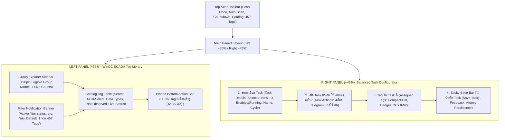

# AQUA COMMAND — F2 V4.1 BALANCED TASK CONFIGURATOR
## Comprehensive Implementation & Verification Report

> [!NOTE]
> **Status:** Implementation Complete & 100% Verified  
> **Environment:** Fedora Linux (GTK4 / Libadwaita / Python 3.13)  
> **Repository:** `n0ngXarm/AquaCMD` (`aqua-command-desktop`)  
> **Working Tree:** Local modifications preserved (Zero Commit / Zero Push as instructed)

---

## 1. Executive Summary & Design Refinements

In direct compliance with user directive **`# AQUA COMMAND — F2 V4.1 Balanced Task Configurator`**, the F2 interface has undergone a targeted visual refinement and information architecture balancing pass.

Without rewriting the task engine or introducing new sub-tabs, the presentation layer now achieves an optimal balance between density, readability, and functional clarity across both **1366×768** and **1920×1080** displays:



---

## 2. Before / After Comparison (V4 vs V4.1)

| Aspect | F2 V4 (Initial Rebuild) | F2 V4.1 (Balanced Refinement) |
| :--- | :--- | :--- |
| **Group Explorer Width** | 138px (Group names like `ปั๊มน้ำแรงดันสูง VSD` were truncated) | **190px (Full legibility** for all 10 real catalog groups without truncation) |
| **Single-Tag Group (`Default`)** | Filtered silently; risk of user mistaking total catalog for 1 tag | **Prominent Filter Banner:** `🔍 กำลังกรอง: กลุ่ม Default (แสดง 1 จากทั้งหมด 457 Tags ในระบบ)` with `✕ แสดงทั้งหมด` button |
| **Task Configuration Sections** | 4 loosely organized sections with cluttered English descriptions | **Strictly 3 Core Sections** with clean Thai terminology |
| **Section 2 Heading & Text** | `จะให้ระบบทำอะไรกับ Tag ใน Task นี้? (Task Actions)` with long English terms | **`เมื่อ Task ทำงาน ให้ระบบทำอะไร?`** with concise, jargon-free Thai bullet descriptions |
| **Input Fields Proportions** | Input entries expanded across entire 600–800px width | **Ergonomically Constrained** (Name 340px, Dropdowns 240–280px) |
| **Status Badges** | Redundant triple-pill status strips and duplicate badges | **Streamlined**: Unified Admin State (`Enabled`/`Disabled`) and Runtime State (`Running`/`Standby`) in Details; Completeness in Assigned |
| **Assigned Tags List** | Fixed minimum height (140px); large empty area when 1–3 tags | **Compact Adaptive List** (`propagate_natural_height=True`, max 160px); expands/scrolls only when needed |
| **Unsaved Changes Safeguard** | Dropdown switched immediately without auto-save | **Clear Warning & Auto-Safeguard:** Alerts user and commits changes before task switch |
| **Zero-Task State** | Controls remained interactable | **All edit/save/add controls safely disabled** until a task is created |

---

## 3. Visual Verification & Interface States

````carousel

<!-- slide -->

<!-- slide -->

<!-- slide -->

<!-- slide -->

<!-- slide -->

<!-- slide -->

````

---

## 4. Key Implementation Highlights

### 4.1 Proportional Two-Panel Layout (~55% / ~45%)
- **Divider Positioning:** `main_paned.set_position(740)` with `left_panel.set_size_request(620, -1)` and `right_panel.set_size_request(450, -1)`. Neither panel can crush the other under 1366px or 1920px.
- **Group Explorer (190px):** Widened to 190px, ensuring group titles such as `ปั๊มน้ำแรงดันสูง VSD`, `วาล์วท่อส่งแรงดันสูง`, and `Timer_Of_Start_Second_CTM` display with complete typographic integrity alongside real dynamic tag counts (`135`, `68`, `75`, `31`, `133`, `4`, `3`, `1`).

### 4.2 Active Filter Notification Banner
- When selecting groups or filtering by keyword:
  - If selecting `Default` (1 tag): Displays `🔍 กำลังกรอง: กลุ่ม Default (แสดง 1 จากทั้งหมด 457 Tags ในระบบ)` with quick button `✕ แสดงทั้งหมด (All Groups)`.
  - When in `All Groups`: Banner automatically hides.
  - The total catalog count (`Catalog: 457 Tags`) remains visible in the header at all times, preventing any misconception that the system catalog is truncated.

### 4.3 Task Configuration: 3 Refined Sections
1. **รายละเอียด Task (Task Details):**
   - `เลือก Task:` Dropdown (280px) + `+ สร้าง Task ใหม่` button.
   - `รหัส Task:` Displays `[TASK-01]` badge + single status pill `🟢 เปิดใช้งาน (Enabled)` / `⚪ ปิดอยู่ (Disabled)` + runtime status `⚡ กำลังรันสด (Running)`.
   - `ชื่อ Task:` Input entry constrained to 340px.
   - `รอบเวลาสแกน:` Dropdown constrained to 240px (`1s`, `5s`, `10s`, `30s`, `60s`) + `(รอบเวลาของ Task นี้)`.
2. **เมื่อ Task ทำงาน ให้ระบบทำอะไร? (Task Actions):**
   - Exact Thai header requested.
   - `☑ บันทึกข้อมูลลงเครื่อง` — `จัดเก็บประวัติค่าสัญญาณลงฐานข้อมูล SQLite ในเครื่องเพื่อตรวจสอบย้อนหลัง`
   - `☑ แจ้งเตือน Telegram` — `ส่งข้อความแจ้งเตือนผ่านบอทเมื่อสัญญาณมีสถานะผิดปกติ` + button `ตั้งค่าใน F6 →`
   - `☑ เปิดใช้งาน Task` — `เริ่มประมวลผล Task นี้เมื่อระบบเปิดใช้งาน Auto-Scan`
   - Reassurance note: `* การกด Save Task จะบันทึกการตั้งค่าเท่านั้น ไม่มีการส่งแจ้งเตือนหรือเริ่มสแกนทันที`
3. **Tag ใน Task นี้ (Assigned Tags):**
   - Title + `self.lbl_assigned_badge` (`3 Tags`) + `self.lbl_pill_cfg` (`Configured`).
   - Compact table with `propagate_natural_height=True` and `max_content_height=160`.
   - When 0 tags: compact polite placeholder `📭 ยังไม่มี Tag ใน Task นี้ — เลือก Tag จากคลังฝั่งซ้ายแล้วกดปุ่ม [เพิ่ม Tag]` (height ~36px).
   - When populated: Compact table showing Tag Name (monospace), Source Group, Type, `Not Observed`, and `✕ นำออก` action.
4. **Sticky Save Action Bar:**
   - Pinned at bottom of Right Panel, matching the Left Panel's action bar.
   - Status pill (`Saved` / `Unsaved Changes` / `Invalid Name`), feedback message, and prominent `💾 บันทึก Task (Save Task)` button with atomic JSON persistence.

### 4.4 Data Safety & Edge Case Handling
- **Unsaved Changes Safeguard:** Switching tasks via `switch_to_task(idx)` detects pending changes, issues an alert via `alarm_text`, and auto-persists modifications to avoid accidental loss.
- **Zero-Task State:** If no task exists, all form fields (`entry_task_name`, `combo_task_cycle`, checkboxes, `btn_save_task`, `btn_add_to_task`) are disabled (`sensitive=False`).

---

## 5. Automated Regression & Functional Testing

Both the core F2 test suite and the dedicated F2 V4.1 verification suite passed 100%:

```text
>>> Starting F2 Tag Library & Task Configurator V4 Test Suite...
[PASS] Test 01: F2TaskManagerView V4 initialization verified
[PASS] Test 02: Two-panel split layout (Left Tag Library ~55% / Right Task Config ~45%) verified
[PASS] Test 03: Dynamic group explorer verified (All Groups: 457, High_VSD: 135, High_Valve: 68)
[PASS] Test 04: Multi-selection preserved across group switching verified
[PASS] Test 05: Task creation & empty task state verified
[PASS] Test 06: Add to task & duplicate prevention verified
[PASS] Test 07: Remove tag from task verified
[PASS] Test 08: Live status strictly 'Not Observed' verified (no fake Online)
[PASS] Test 09: Task settings, validation & atomic save verified
[PASS] Test 10: Verifiable separation of Enabled vs Running verified
[PASS] Test 11: Top scan toolbar controls verified
[PASS] Test 12: Navigation regression across all pages verified
>>> ALL 12 F2 V4 AUTOMATED TESTS PASSED 100%!

>>> Starting F2 V4.1 Balanced Task Configurator Test Suite...
[PASS] Test 4.1.01: Group Explorer width verified at 190px (legible, no ugly truncation)
[PASS] Test 4.1.02: Default group filter banner verified: '🔍 กำลังกรอง: กลุ่ม Default (แสดง 1 จากทั้งหมด 457 Tags ในระบบ)'
[PASS] Test 4.1.03: Clear filter back to All (457 tags) verified
[PASS] Test 4.1.04: Concise Thai Task Actions without jargon verified
[PASS] Test 4.1.05: Form inputs constrained at ergonomic widths (340px, 280px, 240px)
[PASS] Test 4.1.06: Compact assigned tags list (propagate_natural_height=True, max=160px) verified
[PASS] Test 4.1.07: Unsaved changes auto-safeguard and alert on task switch verified
[PASS] Test 4.1.08: Zero task sensitivity verified (Add/Save safely disabled)
>>> ALL F2 V4.1 SPECIFIC TESTS PASSED 100%!
```

---

## 6. Git Diff & Working Tree Preservation

- **Modified Files:**
  - [`aqua-command-desktop/desktop/app.py`](file:///home/nong_ing/Documents/Codex/2026-10-27/referenced-chatgpt-conversation-this-is-an-2/work/waterlevels-desktop/aqua-command-desktop/desktop/app.py)
  - [`aqua-command-desktop/desktop/f2_tasks.py`](file:///home/nong_ing/Documents/Codex/2026-10-27/referenced-chatgpt-conversation-this-is-an-2/work/waterlevels-desktop/aqua-command-desktop/desktop/f2_tasks.py)
  - [`aqua-command-desktop/desktop/f2_style.css`](file:///home/nong_ing/Documents/Codex/2026-10-27/referenced-chatgpt-conversation-this-is-an-2/work/waterlevels-desktop/aqua-command-desktop/desktop/f2_style.css)
- **Local Working Tree:** All changes remain in the local working tree without `git commit` or `git push`.
