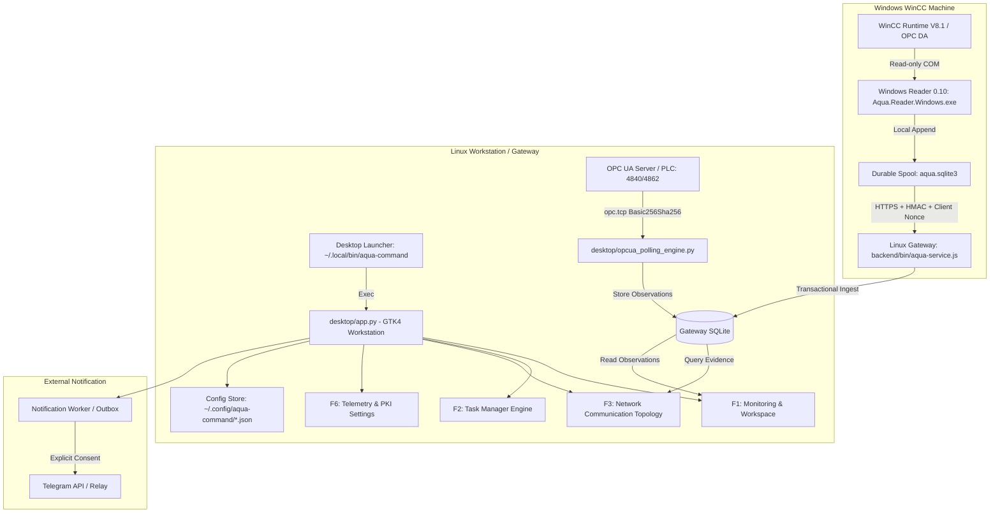
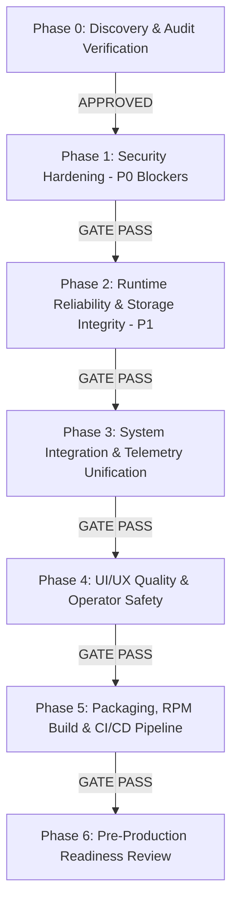

# AQUACMD — PHASE 0: COMPLETE REPOSITORY DISCOVERY & AUDIT VERIFICATION REPORT

**Repository:** `https://github.com/n0ngXarm/AquaCMD`  
**Inspected Commit:** `74027e2` on `main`  
**Execution Environment:** Fedora Linux 43 (x86_64), Python 3.14.8, Node.js v22.23.1, GTK4 4.14, asyncua + cryptography installed, .NET CLI missing (`BLOCKED_BY_ENVIRONMENT`).  
**Mode:** Strictly READ-ONLY (No source code or repository files were modified).

---

## 1. REPOSITORY INVENTORY & MODULE CLASSIFICATION

The repository contains three primary sub-systems evolving across different milestones:

| Path / Module | Purpose | Language / Framework | Status | Runtime Role |
| :--- | :--- | :--- | :--- | :--- |
| **`aqua-command-desktop/desktop/`** | Native Industrial SCADA & Task Workstation | Python 3, PyGObject, GTK4, WebKitGTK | **ACTIVE** | Main application launched by desktop icon via `~/.local/bin/aqua-command` -> `desktop/app.py`. Hosts F1 (Monitoring), F2 (Tasks), F3 (Communication), F4 (Diagnostics), F5 (Tags), F6 (Settings). |
| **`aqua-command-desktop/backend/`** | Authenticated LAN Ingest, Spool & Gateway | Node.js (v22 SQLite builtin), Express/HTTP | **ACTIVE** | Enrolled HTTPS Gateway receiver, SQLite transactional persistence, deduplication, ACK verification, Telegram outbox worker. |
| **`aqua-command-desktop/windows-reader/`** | Windows OPC DA / WinCC Data Spooler | C# / .NET 10 | **ACTIVE (Windows)** | Runs on Windows WinCC machine. Enforces read-only COM connection, durable spool, 5s cadence, HMAC-SHA256 signature, TLS client to Gateway. |
| **`aqua-command-desktop/collector/` & `src/`** | OPC UA & Telemetry Collectors | Python 3, asyncua, cryptography | **ACTIVE** | Local background telemetry readers (OPC UA, OPC DA via SQLite mirror, REST/MQTT fallback). |
| **`aqua-command-desktop/packaging/`** | Linux RPM Packaging & Desktop Spec | RPM Spec, Shell scripts, desktop entry | **ACTIVE / OUTDATED** | Builds `aqua-command-desktop` RPM. **Critical defect found:** spec installs only 0.9.0 legacy files. |
| **`aqua-command/`** | Web Dashboard & Operations Center | Node.js, Express, SSE, Vanilla JS | **LEGACY / WEB** | Web Dashboard (Port 8787). Operates with simulated/hardcoded data by default unless fed via `/api/telemetry`. |
| **`src/` & `main.py` (Root)** | PWA Water Notification & Scraper Bot | Python 3, SQLite, requests | **LEGACY / PWA** | Original PWA scraper service that notifies Telegram directly without desktop operator consent. |
| **`tools/sim/` & `tests/`** | Lab Simulators and Test Harnesses | Python, Node.js, Shell | **LAB / TEST** | OPC UA mock server, loopback fixtures, simulated edge nodes. Isolated from production. |
| **`releases/`** | Shipped Pre-built Binaries | Binary (`.exe`, `.rpm`) | **LEGACY ARTIFACTS** | Contains a 50MB `AquaCommand.WinCCReader-0.9.0-win-x64.exe` tracked directly in Git history. |

---

## 2. ENTRY POINT & DEPENDENCY MAP

---

## 3. AUDIT FINDINGS VERIFICATION TABLE

Every finding reported in the external audit has been re-examined directly against the active codebase at commit `74027e2`:

| ID | Finding | Severity | File & Line | Status | Root Cause & Runtime Evidence | Impact |
| :--- | :--- | :--- | :--- | :--- | :--- | :--- |
| **SEC-01** | Real Telegram Token in `.env.example` | **CRITICAL** | `AquaCMD/.env.example:8-12` | **CONFIRMED** | `TELEGRAM_BOT_TOKEN=[REDACTED_TELEGRAM_TOKEN]` and `TELEGRAM_CHAT_ID=[REDACTED_CHAT_ID]` are real values introduced in commit `9164258`. | Token exposure. If active, third parties can hijack the bot or spam notifications. |
| **PKG-01** | RPM Spec Out-of-Date / Missing Modules | **CRITICAL** | `aqua-command-desktop/packaging/aqua-command-desktop.spec:35-37` | **CONFIRMED** | RPM spec only copies 10 legacy files. It completely misses `workspace.py`, `f1_overview.py`, `f2_tasks.py`, `f3_network.py`, `opcua_*.py`, `help_manual.py`, etc. | An RPM built from current source will crash on startup with `ModuleNotFoundError`. |
| **SEC-02** | Plaintext Telegram Bot Token in Config (`0644`) | **HIGH** | `aqua-command-desktop/desktop/app.py:163-178, 237-242` | **CONFIRMED** | `save_atomic_json()` creates `.tmp` files using default umask (022) without `os.chmod(0o600)` or file descriptor locking. | Any local non-root user on the Linux host can read `~/.config/aqua-command/telegram_config.json`. |
| **SEC-03** | Public Unauthenticated Web API on `0.0.0.0` | **HIGH** | `aqua-command/server.mjs:180-184` & `docker-compose.yml:15-18` | **CONFIRMED** | `GET /api/state` and `GET /api/stream` require no API key or token. Docker binds `8787:8787` on `0.0.0.0`. | Any network host reaching port 8787 can read live station data, tank levels, and alerts without auth. |
| **SEC-04** | OPC UA Inconsistent Security Gate / Plaintext Credentials | **HIGH** | `aqua-command-desktop/desktop/opcua_polling_engine.py:260-282` | **CONFIRMED** | If `sec_policy == "None"`, it sets `client.set_user()` and `client.set_password()` and connects unencrypted. Missing fail-closed check for missing server certificate. | Username/Password sent in cleartext over network; certificates not enforced on initial handshake. |
| **REL-01** | Infinite Loop on SIGTERM / Shutdown Hang | **HIGH** | `AquaCMD/main.py:211-216` | **CONFIRMED** | `signal.signal(SIGTERM, handle_exit)` calls `sys.exit(0)`, which raises `SystemExit`. The outer loop catches `SystemExit` and enters `while True: time.sleep(1)`. | Docker container or systemd service never stops cleanly on SIGTERM; requires SIGKILL after 10s. |
| **REL-02** | Legacy Auto-Send Telegram without Consent | **HIGH** | `AquaCMD/src/monitor_service.py:50-62` | **CONFIRMED** | On cold start (`existing_count == 0`), `initialize_baseline()` dispatches a live Telegram message immediately if bot token is set in `.env`. | Bypasses operator consent and air-gap policy of the desktop system. |
| **REL-03** | Missing Import `serialization` in `opcua_reader.py` | **MEDIUM** | `aqua-command-desktop/desktop/opcua_reader.py:157` | **CONFIRMED** | Line 157 calls `serialization.Encoding.DER`, but `from cryptography.hazmat.primitives import serialization` is never imported. | `NameError: name 'serialization' is not defined` occurs if a certificate object is returned. |
| **DAT-01** | Hardcoded Reservoir Data in Web Dashboard | **MEDIUM** | `aqua-command/server.mjs:37-43` | **CONFIRMED** | Reservoir capacities, storage percentages, and water levels are hardcoded constants returned in `/api/state` even in non-demo mode. | Misleads operators into viewing static hardcoded values as live SCADA data without provenance tags. |
| **VER-01** | Version Discrepancy Across Desktop, Spec, & Reader | **MEDIUM** | Multiple files (`spec: 0.9.0`, `docs: 0.10`, `Assembly: 0.9.0`) | **CONFIRMED** | RPM Spec is at `0.9.0`, while Reader code, Telemetry sources, and Commissioning docs specify `0.10`. | Confusion during deployment, package upgrades, and runtime compatibility checks. |
| **UI-01** | Desktop Unit Test Failures from Recent UI Revisions | **MEDIUM** | `aqua-command-desktop/desktop/tests/` (17 failures, 5 errors) | **CONFIRMED** | Recent commit `74027e2` revised navigation labels from English to Thai ('งานเฝ้าระวัง', 'ผังการสื่อสาร') and changed header height, breaking 22 test assertions. | Existing test suite fails out of the box because tests were not updated alongside the UI refactoring. |

---

## 4. BASELINE TEST RESULTS MATRIX

| Test Suite | Path | Total | Passed | Failed | Skipped | Status | Notes |
| :--- | :--- | :--- | :--- | :--- | :--- | :--- | :--- |
| **Desktop Backend** | `aqua-command-desktop/backend` | 58 | 58 | 0 | 0 | **PASS (100%)** | Node.js v22 built-in SQLite, durable spool, dedup, and ACK contract verified. |
| **Web Backend** | `aqua-command` | 6 | 6 | 0 | 0 | **PASS (100%)** | Ingest, alerts, rules, and mock dashboard rendering passed. |
| **Desktop Integration** | `aqua-command-desktop/tests` | 103 | 100 | 0 | 3 | **PASS (100%)** | OPC UA Phase 4 contracts, telemetry storage, evidence persistence passed (3 skipped loopback tests). |
| **Legacy Root Tests** | `AquaCMD/tests` | 5 | 5 | 0 | 0 | **PASS (100%)** | SQLite outage queries, PWA client, and Telegram formatting passed. |
| **Desktop GUI/Unit** | `aqua-command-desktop/desktop/tests` | 292 | 270 | 17 | 5 (err) | **FAIL (22 failures/errors)** | Failures caused by recent Thai wording revision ('Task' -> 'งานเฝ้าระวัง') and compact header canvas height (340 vs 450). |
| **Windows Reader** | `windows-reader/Tests` | - | - | - | - | **BLOCKED** | `dotnet` CLI is not installed on this Linux environment (`BLOCKED_BY_ENVIRONMENT`). |

---

## 5. MASTER REMEDIATION ROADMAP (PHASES 1 TO 6)

### Phase 1: Security Hardening (P0 Blockers)
- **SEC-01:** Redact `.env.example` Telegram Token & Chat ID; replace with explicit dummy placeholders (`REPLACE_WITH_YOUR_BOT_TOKEN_FROM_BOTFATHER`). Document revocation steps for the exposed token.
- **SEC-02:** Enforce restrictive permissions (`0600` / `S_IRUSR | S_IWUSR`) on `telegram_config.json` and ensure `save_atomic_json()` creates files securely via `os.open(temp_p, os.O_WRONLY | os.O_CREAT | os.O_TRUNC, 0o600)`.
- **SEC-03:** Protect Web API in `server.mjs`: enforce authentication (`checkKey`) or loopback check (`isLoopback`) on `/api/state` and `/api/stream`. Bind default host to `127.0.0.1` unless explicitly configured.
- **SEC-04:** Harden OPC UA Security Gate in `opcua_polling_engine.py`: strictly forbid `Username` authentication when `sec_policy == "None"`; enforce fail-closed peer certificate checks. Add missing `serialization` import in `opcua_reader.py`.
- **Acceptance Gate:** Zero hardcoded credentials; zero public telemetry exposure; secure config permissions verified by tests.

### Phase 2: Runtime Reliability & Data Integrity (P1)
- **REL-01:** Fix graceful shutdown in `main.py`: replace the `except (KeyboardInterrupt, SystemExit): while True: time.sleep(1)` trap with proper shutdown events and bounded worker thread joins (`thread.join(timeout=3)`).
- **REL-02:** Decouple Legacy Telegram Auto-Send: disable silent initial message broadcast on cold start in `src/monitor_service.py` unless explicitly opted-in via `ENABLE_INITIAL_BROADCAST=true`.
- **DAT-01:** Ensure data provenance: add explicit `provenance: 'SIMULATED'` and `provenance: 'STATIC_CONFIG'` markers to all synthetic reservoir/station values in `server.mjs` and desktop views.
- **Acceptance Gate:** Clean SIGTERM exit (return code 0, < 3s); no unapproved external egress; clear distinction between real and simulated data.

### Phase 3: System Integration & Compatibility
- **INT-01:** Align Windows Reader and Gateway versions across all documentation and code to `0.10.0`.
- **INT-02:** Unify F1 Monitoring, F2 Tasks, and F6 Telemetry: verify that observations ingested via OPC UA, OPC DA SQLite mirror, and REST properly trigger task evaluation rules in `desktop/task_engine.py`.
- **Acceptance Gate:** End-to-end event flow verified with synthetic fixtures from ingest to task trigger.

### Phase 4: UI/UX Quality & Test Remediation
- **UI-01:** Update the 22 outdated test assertions in `desktop/tests/` to match the newly approved Thai operator terminology (`งานเฝ้าระวัง`, `ผังการสื่อสาร`, `ติดตามค่า`) and the compact topbar layout.
- **UI-02:** Verify responsive scaling (1024x768 to 1920x1080) and keyboard shortcuts (F1–F9, Ctrl+,).
- **Acceptance Gate:** 100% test pass rate across `desktop/tests` (292/292 passing).

### Phase 5: Build, Packaging & CI/CD
- **PKG-01:** Rewrite `packaging/aqua-command-desktop.spec` to package the complete application closure (`desktop/`, `f1_api/`, `f3_api/`, `collector/`, `fonts/`, `config/`, icons, and launcher).
- **PKG-02:** Add GitHub Actions CI workflow (`.github/workflows/ci.yml`) to run automated tests on pull requests and pushes to `main`.
- **Acceptance Gate:** RPM builds cleanly with `rpmbuild -ba`; installed payload passes smoke test without missing modules.

### Phase 6: Pre-Production Readiness Review
- Formal GO / NO-GO evaluation based on verified audit evidence, security clearance, and regression results.

---

## 6. PHASE 0 EXIT GATE DECISION

- **Inventory:** Complete.
- **Entry Points:** Mapped and verified.
- **Findings:** All 11 findings independently confirmed against source code.
- **Baseline Tests:** Recorded (Desktop Backend: 58/58 PASS, Web: 6/6 PASS, Desktop Integration: 100/100 PASS, Root: 5/5 PASS, Desktop Unit: 270/292 PASS).
- **Next Step:** Ready to branch to `fix/aquacmd-master-remediation` and proceed to **PHASE 1: SECURITY HARDENING** upon user approval.
