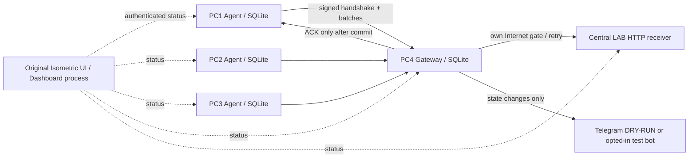

# AQUA COMMAND v0.4 — Real LAN LAB

Continuation of the original v0.3 isometric desktop demo. The existing pump scene, branding, sidebar, chart and event panel remain; telemetry now comes from independent role services and authenticated TCP requests.

**SIMULATED:** pump runtime, flow/pressure model and Internet toggle. **TESTED ON ONE HOST:** three agent OS processes, Gateway, Central mock and Dashboard over real loopback HTTP, durable SQLite, retries and installation. **NOT VERIFIED: two physical hosts**, Windows execution, real Telegram delivery, physical power-loss durability or PLC/WinCC access. This is a LAB demo.

## Start on Linux

Requires Node.js **22.13 or newer** and npm. There are no third-party dependencies or native compilation. Node22 prints an expected experimental SQLite warning. Tested with Node22.23.1 on Linux.

```sh
npm install --offline --ignore-scripts --no-audit --no-fund
npm test
npm run demo:single
```

Open http://127.0.0.1:4173 . `npm run dev` and `npm start` run the same service supervisor. Gateway begins absent and Internet gate DOWN. Click CONNECT GATEWAY, then Internet ON to drain backlog into Central mock. The UI clearly labels Telegram DRY-RUN. No external requests occur by default. Use a distinct data directory/port to keep demonstrations separate:

```sh
npm run dev -- --data-dir ./lab-data-presentation --port 4173
npm run demo:single -- --data-dir ./lab-data-observe --port 4273 --read-only
```

Stop with Ctrl+C; reuse the same data directory to recover retained data. RESET LAB starts a new archived session, retaining old SQLite databases and immutable enrollment files. Never delete enrollment or just one role's DB in a session: sequence identity and receiver history must stay consistent. Existing enrollment pins ports and the read-only flag remains enabled once selected; a new data directory restores defaults. Legacy v0.3 `data/` is not migrated or overwritten.

## Pipeline



Each agent exports every5000ms to its own `aqua.sqlite3` before transport. The first snapshot is at startup. A separate retry worker sends ordered batches of up to32 to the explicitly enrolled Gateway. HMAC binds method/path/timestamp/nonce/body; signed responses bind request nonce and ACK digest. No discovery scan occurs. Fixed endpoint enrollment plus handshake finds the approved Gateway when it returns.

Gateway commit precedes ACK. Sources retain unACKed rows. Dropped ACKs replay the same event ID; duplicate packets have one receiver effect. Gateway retains a separate durable forwarding state and transition notification queue. Default Central is an optional LAB receiver; standalone Gateway works without `upstream`, retaining raw history and delivering transitions to its sink. Internet UP in default mode is a simulated gate, never proof of external Internet. TCP reachable, Gateway authenticated, source ACKed, Central delivered and notification sent are different statuses.

SQLite uses WAL and synchronous FULL transactions. Defaults: pending cap10000/source, latest2000 ACKed rows/source, receiver ledger cap50000, database page cap approximately64MiB plus WAL/SHM (WAL checkpoint256 pages, journal-size target4MiB after checkpoint). Logs retain1000 rows. Receiver dedup history is retained; at quota the pipeline backpressures and reports errors instead of silently dropping unACKed data. This bounded demo needs a new archived session for long-running use; it is not an unlimited historian. A disk-full/export error means a new sample may not be created; old committed records remain.

## Separate LAN roles

```sh
npm run enroll -- --data-dir ./lab-enrollment --port 4173
npm run demo:lan -- --role gateway --config /absolute/path/from/enroll/gateway.json
npm run demo:lan -- --role agent --config /absolute/path/from/enroll/PC-01.json
```

Initial files use loopback. LAN deployment requires deliberately edited private-IP endpoints, per-machine data paths, explicit `allowLan:true`, and `--allow-lan`. Isolated trusted HTTP additionally requires `allowInsecureLabHttp:true`; use verified HTTPS with an approved CA where possible. Only the requested role starts. There is no scan, public/wildcard default listener, route, bridge, NAT, Internet sharing or automatic firewall change. The LAN Dashboard is a local read-only viewer. See [LAN_SETUP_TH.md](docs/LAN_SETUP_TH.md) before copying any enrolled files. Two-host setup instructions are **not a two-host test result**.

## Optional Telegram test bot

The default dry-run needs no token, chat ID or Internet. Real mode requires all four environment variables in `.env.example`, `TELEGRAM_ENABLED=true`, numeric chat ID and exact approved endpoint `https://api.telegram.org`, plus `--internet real`. The app does not auto-load `.env`. Only Gateway gets these variables in single mode. Never put token values in shell history, reports, screenshots or source.

Real Gateway verifies its own egress using Bot API getMe over verified HTTPS443, then sends labelled LAB state changes using sendMessage. No other LAN PC is probed. Failed/429 responses retain notifications, honor retry_after and persist a shared cooldown. Telegram has no event-id idempotency API: timeout after server acceptance can cause a duplicate on retry. Exactly-once effects are proven only for the LAB mock/dry-run, not Telegram. Real delivery was **not exercised** here.

## Run on Windows

Install Node22.13+ and npm through your approved process. Extract the source, open PowerShell in its folder and run the same npm commands. Paths can be absolute Windows paths. Keep data on local disk, restrict enrollment with Windows ACLs, and stop with Ctrl+C. Ownership checks use read-only PowerShell process-creation identity; if unavailable, startup fails closed. Windows operation and firewall settings were **not executed or altered** during this task. No service installation is required.

## Validation and handover

```sh
npm test
npm pack --dry-run
npm pack
# In a separate clean folder:
npm install --offline --ignore-scripts --no-audit --no-fund /absolute/path/aqua-command-isometric-demo-0.4.0.tgz
node node_modules/aqua-command-isometric-demo/bin/aqua-demo.js --data-dir ./lab-data
```

The original four simulator tests remain as legacy regressions; new integration tests exercise actual OS processes and HTTP. Timers are accelerated in most tests; a G5 acceptance test measures the unmodified5000ms cadence. No external test calls are made. See [Thai quick start](README_TH.md), [3–5 minute script](docs/DEMO_SCRIPT_TH.md), [acceptance/evidence](docs/ACCEPTANCE.md), [rollback](docs/ROLLBACK.md), and [WinCC preflight](docs/WINCC_READONLY_PREFLIGHT.md). Stage reports G0–G5 are under `docs/stages/`.

The `wincc-readonly` adapter deliberately fails unavailable; no driver, PLC address mapping or real commands exist. WinCC Tag Configuration export is not runtime data. DB22/DB34 meanings remain unverified.
